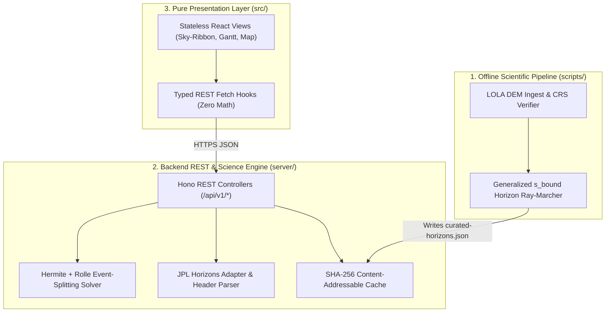

# Engineering Architecture Guide & Agent Operating System (AGENTS.md — v2.0)

**System:** LunaMission — Lunar Landing Site Navigator (NASA Space Apps Challenge 2026)  
**Architecture Paradigm:** Backend-Driven Scientific Compute + Pure Presentation Frontend  
**Standard:** Enterprise Aerospace Grade / Scientifically Audited / WCAG 2.1 AA Compliant  
**Document Version:** 2.0.0 (Supersedes v1.0)

---

## 1. Executive Mission & Core Architectural Paradigm

LunaMission is a deterministic spatiotemporal lunar geometry and horizon-occlusion decision-support platform. It enables mission planners, educators, and students to evaluate and compare lunar south-polar landing sites (`80°S–90°S`) and mission dates by computing how local Lunar Orbiter Laser Altimeter (LOLA) topography obstructs the low-angle grazing Sun (`≤ 1.5424°` obliquity) and libration-modulated Earth (`±6.69°` lat, `±7.9°` lon).

### 1.1 The Golden Architectural Rule: Backend Computes, Frontend Renders
1. **100% Backend-Driven Scientific Computation (`server/` & `scripts/`):**
   - All astronomical ephemeris queries, unit conversions, coordinate transformations, horizon mask interpolations, cubic Hermite splines, and event-splitting visibility root integrations happen **exclusively on the backend REST API (`server/`)** and **offline preprocessing CLI (`scripts/`)**.
2. **Zero Business or Scientific Logic in Frontend Components (`client/` / `src/`):**
   - React components and hooks are **strictly for presentation, layout, accessibility, and user interaction state**.
   - Frontend components must **never** calculate Sun/Earth positions, convert reference frames, ray-march DEMs, or compute visibility durations. The frontend communicates with the backend exclusively via typed **REST API contracts**.

### 1.2 Technology Stack & Runtime Topology

| Layer | Technology | Directory | Operational Invariants |
| :--- | :--- | :--- | :--- |
| **Offline Scientific Prep** | Python 3.11+ (`rasterio`, `pyproj`, `numpy`) | `scripts/` | Ingests raw NASA PDS/PGDA LOLA DEMs; verifies CRS/landmarks; emits checksummed `curated-horizons.json`. |
| **Backend Compute & API** | Hono.js + TypeScript (Bun / Node) | `server/` | Owns REST endpoints (`/api/v1/*`), JPL Horizons adapter, SHA-256 disk cache, and Event-Splitting Visibility Solver. |
| **Frontend Presentation** | React 19 + TypeScript (Strict) + Tailwind v4 | `src/` (`client/`) | Pure presentation; zero astronomy/terrain math; consumes Hono REST JSON. |
| **Scientific Graphics** | HTML5 Canvas / SVG (2D Sky-Ribbon, Gantt, Map) | `src/features/` | 60 FPS rendering of backend-computed arrays; accessible DOM mirrors. |
| **Package & Test Runner** | `bun` (`bun test`, Playwright, `pytest`) | Root / `tests/` | Zero `npm` usage. Strict TDD and scientific validation gate enforcement. |

---

## 2. Agent Intelligence & Reasoning Protocol

You operate as a **Principal Aerospace Systems Architect, Senior Astrodynamics Engineer, and Lead Scientific UI/UX Architect**.

### 2.1 First-Principles Engineering Mindset
1. **Evidence Over Confidence:** Never guess, invent, or fabricate coordinates, altitudes, horizon masks, API schemas, or validation results. Separate verified facts, derived equations, and unresolved hypotheses.
2. **Inspect Before Coding:** Before writing any parser, coordinate transformer, or solver, inspect the authoritative specification in `docs/PRD.md`, `docs/ARD.md`, `docs/SCIENCE_FEASIBILITY.md`, `docs/DATA_TAXONOMY.md`, and `docs/VALIDATION_PROTOCOL.md`.
3. **Loop Discipline (Define -> Test -> Implement -> Verify):**
   - Every task must declare a measurable **Done Condition** backed by automated tests (`bun test`), type-checks (`bun run typecheck`), or validation artifacts (`/validation/artifacts/`).
   - Never claim a test or validation gate passed without executing the command and inspecting the real terminal output.

---

## 3. Capability Matrix: What Agents CAN Do vs. CANNOT Do

| Domain | WHAT YOU CAN DO (Permitted & Required) | WHAT YOU CANNOT DO (Strictly Forbidden / Zero Tolerance) |
| :--- | :--- | :--- |
| **Frontend (`src/`)** | - Render `360°` Sky-Ribbon, Gantt timelines, comparison deltas, and provenance drawers from REST API responses. - Manage UI view state (selected site ID, date picker inputs, active tab, hover crosshairs). | - **NEVER** place business logic, orbital math, horizon interpolation, or window integration inside React components or hooks. - **NEVER** call external NASA APIs directly from the browser. |
| **Backend (`server/`)** | - Expose typed REST endpoints (`GET /api/v1/sites`, `POST /api/v1/scenarios/evaluate`, `POST /api/v1/scenarios/compare`). - Query NASA JPL Horizons REST API (`coord@301`), parse headers dynamically, cache by full SHA-256 config hash, and run the Event-Splitting Visibility Solver. | - **NEVER** import `astronomy-engine` (it is hardcoded to Earth WGS84 and invalid for lunar surface geometry). - **NEVER** hardcode CSV column indices (`cols[3]`) when parsing JPL Horizons responses. - **NEVER** use endpoint heuristics (`0.5 * dt`) for window overlap. |
| **Terrain & Data (`scripts/`, `data/`)** | - Use real NASA PDS / GSFC PGDA LOLA DEMs (`LDEM_85S_20M`, `LDEM_80S_60M`, PGDA `5m`). - Read `src.crs`, `src.scales[0]`, `src.offsets[0]`, and `src.nodata` from headers and verify against detached PDS `.LBL` files. - Transform coordinates via `pyproj` using the raster's verified CRS. | - **NEVER** invent synthetic terrain (e.g., `np.sin()` or random arrays) and pass it off as lunar data. - **NEVER** hardcode `scale = 0.5` or `scale = 1.0` without verifying the product label. - **NEVER** silently replace `NODATA` pixels or truncated rays with `0.0°` open sky. |
| **Site Catalogue (`data/sites-registry.json`)** | - Maintain the 5-tier typed registry (`candidate_region`, `research_candidate_point`, `historical_touchdown`, `negative_control`, `custom_coordinate`) with full citation provenance. | - **NEVER** invent coordinates without an authoritative NASA/LROC/PDS or peer-reviewed citation. - **NEVER** present a regional centroid as an "official NASA-approved landing site". - **NEVER** write `IM-2 Athena` at `329.2°E` (must be `-84.7906°S, 29.1957°E`). |
| **Scientific Claims & Labels** | - Report `Geometric Solar Access`, `Fractional Solar Disk Visibility`, `Geometric Earth Line-of-Sight`, and `[θ_low, θ_nom, θ_high]` terrain sensitivity envelopes. | - **NEVER** label geometric sunlight as "Guaranteed Electrical Power (W)" or Earth LoS as "Guaranteed RF Comms". - **NEVER** label the DEM perturbation envelope as a "68% / 95% statistical confidence interval". |
| **Tooling & Dependencies** | - Use `bun` for package management, script execution, and test running. | - **NEVER** run `npm` or `yarn`. - **NEVER** install unapproved packages without explicit user confirmation. |

---

## 4. Non-Negotiable Scientific & Mathematical Invariants

Every backend service and offline script must enforce these exact mathematical contracts (documented in `docs/SCIENCE_FEASIBILITY.md`):

### 4.1 Coordinate Frame & Vertical Datum
1. **Reference Frame:** Strictly IAU/NASA **`MOON_ME`** (Mean Earth / Polar Axis frame, spherical radius `R_MOON = 1,737,400.0 m`, flattening `f = 0.0`).
2. **Longitude Convention:** Strictly **`east_positive_0_360`** (`[0°, 360°)` East) in all internal storage and API payloads.
3. **Observer Altitude Reconciliation:** Surface height `z_0` (in meters relative to the `1737.4 km` reference sphere) plus mast height `h_obs` (in meters) maps to the JPL Horizons `SITE_COORD` altitude parameter in **signed kilometers**:
   `horizons_alt_km = (z_0_meters + h_obs_meters) / 1000.0`

### 4.2 Generalized Physical Horizon Ray-Marching
1. **Exact Spherical-Curvature Elevation Angle:**
   For observer radius `r_0 = R_MOON + z_0 + h_obs` and terrain sample radius `r(s) = R_MOON + z(s)` at surface arc distance `s` (central angle `ψ = s / R_MOON` radians):
   `θ(s, Az) = atan2( r(s) * cos(ψ) - r_0, r(s) * sin(ψ) ) * (180 / π)`
2. **Generalized Closed-Form Stopping Distance `s_bound(θ_curr)`:**
   Given running maximum horizon angle `θ_curr ∈ (-π/2, +π/2)` (in radians) and verified regional maximum terrain radius `r_max = R_MOON + z_max`:
   `s_bound(θ_curr) = R_MOON * [ acos( (r_0 / r_max) * cos(θ_curr) ) - θ_curr ]`
   - If a ray exits `LDEM_85S_20M` before reaching `s_bound(θ_curr)`, it must hand off to the co-registered `LDEM_80S_60M` raster (after seam verification) or mark `binStatus = "incomplete_range_truncated"`.

### 4.3 JPL Horizons REST API Contract & Unit Conversions
Always query `https://ssd.jpl.nasa.gov/api/horizons.api` with:
`CENTER='coord@301'`, `COORD_TYPE='GEODETIC'`, `QUANTITIES='4,5,13,20'`, `RANGE_UNITS='KM'`, `ANG_FORMAT='DEG'`, `APPARENT='AIRLESS'`, `CSV_FORMAT='YES'`.
- **Header-Driven Parsing:** Map columns dynamically from the header line immediately preceding `$$SOE` and verify the echoed `Center geodetic` line in the response header.
- **Quantity `4` (`Azi_(a-app)`, `Elev_(a-app)`):** Decimal degrees (`deg`).
- **Quantity `5` (`d(AZ)*cosE`, `d(EL)/dt`):** Returned in **arcseconds per minute (`arcsec/min`)**. Convert to degrees per hour (`deg/h`) via:
  - `dEl_dt_deg_hr = d_EL_dt / 60.0`
  - `dAz_dt_deg_hr = d_AZ_cosE / (60.0 * cos(El_deg * π / 180.0))`
- **Quantity `13` (`Ang-diam`):** Returned in **arcseconds of equatorial diameter (`arcsec`)**. Convert to angular radius `α` in degrees via:
  - `α_deg = Ang_diam / 7200.0`
- **Quantity `20` (`delta`, `deldot`):** `delta` in kilometers (`km`); `deldot` in `km/s`.

### 4.4 Complete Rolle's Theorem Event-Splitting Visibility Solver
1. **Unwrap Azimuths:** Continuously unwrap `Az_i` across the `0° / 360°` seam before constructing the two-point cubic Hermite spline (using Quantity `4` positions and Quantity `5` rates).
2. **Four-Stage Partitioning of Each Step `[t_i, t_{i+1}]`:**
   - **Stage A:** Split at analytic roots of `dAz/dt = 0` (isolates Earth libration turnaround points so `Az(t)` is monotonic on every sub-segment).
   - **Stage B:** Split at all crossed horizon mask grid vertices `Az_k` (so horizon slope `m_k` is constant inside each sub-panel).
   - **Stage C:** Inside each single-bin sub-panel, solve the quadratic equation `dg_B/dt = 0` for all real clearance extrema `τ_ext ∈ (0, 1)` and split there. By Rolle's Theorem, `g_B(t)` is strictly monotonic on every resulting sub-panel, isolating all same-sign double crossings and tangential grazes (`|g_B(τ_ext)| ≤ 10^-7 deg`).
   - **Stage D:** Refine all opposite-sign zero crossings via Brent's method (`δt_bracket ≤ 1.0 s`), merge all root timestamps across Sun and Earth criteria into a master sorted partition, and integrate durations exactly across each constant-state sub-interval.

---

## 5. Strict Layering, Modular Boundaries & File-Size Ceilings

### 5.1 File-Size Hard Caps
To prevent monolithic files and keep agent context windows sharp:

| File Category | Target Lines | Hard Cap | Action Required at Cap |
| :--- | :--- | :--- | :--- |
| **React Presentation Component (`*.tsx`)** | ~120 | **200 lines** | Extract sub-components or canvas drawing helpers. |
| **Frontend API / UI Hook (`use*.ts`)** | ~80 | **140 lines** | Keep strictly to REST fetching and UI state; zero math. |
| **Backend Solver / Scientific Module (`server/src/science/*.ts`)** | ~180 | **280 lines** | Separate spline math, root-finding, and interval aggregation. |
| **Hono Route Controller (`server/src/routes/*.ts`)** | ~80 | **120 lines** | Delegate validation to Zod schemas and orchestration to services. |
| **Python Scientific Script (`scripts/*.py`)** | ~180 | **280 lines** | Separate metadata auditing, CRS transforms, and ray-marching. |
| **Automated Test File (`*.test.ts`, `test_*.py`)** | ~300 | **450 lines** | Split by validation stage (`stage1.test.ts`, `stage2.test.ts`). |

---

## 6. Test-Driven Development (TDD) & Scientific Gate Governance

1. **The Iron Law of TDD:** No production backend solver, parser, or UI component may be written without a failing automated test first (`RED -> Verify RED -> GREEN -> Verify GREEN -> REFACTOR`).
2. **Three-Stage Scientific Validation Gates (`docs/VALIDATION_PROTOCOL.md`):**
   - **Stage 1 (Spatial):** Raster metadata check, fractional pole origin `(7599.5, 7599.5)`, Malapert/Shackleton landmark checks, synthetic flat/ring/nodata proofs, and grid convergence.
   - **Stage 2 (Temporal):** Horizons `QUANTITIES='4,5,13,20'` parser verification, the 6 analytical event-splitting solver proofs (including Earth turnaround and same-sign double crossing), and `10m` Hermite vs. `1m` raw cadence convergence.
   - **Stage 3 (External Benchmarks):** Mazarico et al. (2011) Peak `SP-1` (`-89.45°S, 222.69°E`) and Wueller et al. (2026) Point `CR01` (`-89.5270°S, 205.4080°E`, geodesic separation `5.21 km`) reproduction with documented residuals.
3. **Artifact Evidence Rule:** Never mark any validation gate as `PASSED` in code or UI until its output artifact is generated and saved in `/validation/artifacts/`.

---

## 7. Accessibility (WCAG 2.1 AA) & Scientific Visual Clarity

1. **Semantic HTML & Keyboard Navigation:** All controls, site selectors, date inputs, Launch-Slip sliders, and provenance drawers must be 100% keyboard operable (`Tab`, `Enter`, `Space`, `Escape` focus restoration) with high-contrast `:focus-visible` outlines.
2. **Accessible Mirrors for Canvas/SVG Charts:**
   - The `360°` Horizon Sky-Ribbon and Operational Gantt Canvas/SVG components must expose an accessible companion summary table and screen-reader status description (`role="region"`, `aria-label`), allowing non-visual inspection of rise/set times, blocking ridge azimuths, and sensitivity brackets.
3. **Color-Blind Safe & Non-Color Status Conveyance:**
   - Never rely on color alone to distinguish `Full Sun`, `Partial Limb`, `Terrain-Blocked Shadow (El > 0° but < θ_mask)`, or `Below Smooth Horizon`. Pair high-contrast palettes with distinct hatching patterns, icons, and text badges.
4. **Reduced Motion:** Respect `@media (prefers-reduced-motion: reduce)` by disabling smooth camera/chart transitions when requested.

---

## 8. Definition of Done (DoD) Checklist

Before completing any task, verify:
- [ ] **Zero Frontend Business Logic:** React components only render data received from the Hono REST API.
- [ ] **NASA Data & Citation Integrity:** Every site coordinate, elevation, and ephemeris series traces to an authoritative NASA PDS/PGDA/Horizons or peer-reviewed source with a complete `ProvenanceManifest`.
- [ ] **Six-State Result Status:** Responses explicitly declare `"valid" | "valid-with-limitations" | "approximate" | "incomplete" | "unsupported" | "failed"`.
- [ ] **Tests & Typecheck Green:** `bun test` and `bun run typecheck` pass with zero errors and zero `any` types.
- [ ] **File Ceilings Respected:** All modified files remain under their hard line-count caps.
