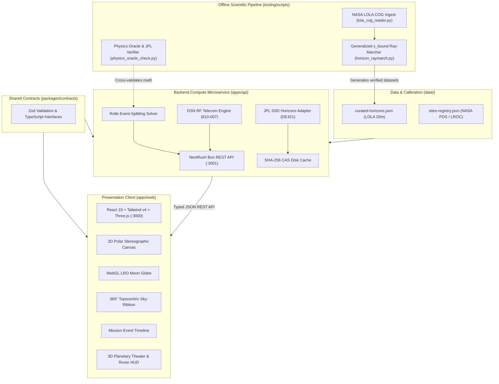

# LunaMission — Lunar Landing Site Navigator

[](https://www.spaceappschallenge.org/2026/challenges/lunar-landing-site-navigator/)
[](https://bun.sh/)
[-3776ab.svg)](tooling/)
[](https://react.dev/)
[-orange.svg)](apps/api/src/app.ts)
[](tests/)
[-3178c6.svg)](tsconfig.json)
[](https://www.w3.org/WAI/WCAG21/quickref/)
[-purple.svg)](docs/SCIENCE_FEASIBILITY.md)
[](LICENSE)

**LunaMission** is an aerospace-grade lunar landing site decision-support platform engineered for the **NASA Space Apps Challenge 2026**: [**Lunar Landing Site Navigator**](https://www.spaceappschallenge.org/2026/challenges/lunar-landing-site-navigator/).

Designed for planetary scientists, mission planners, flight dynamics engineers, educators, and aerospace students, LunaMission provides deterministic mathematical rigor, transparent error budgets, and authoritative NASA citations to evaluate, compare, and rank lunar south-polar landing zones ($80^\circ\text{S} - 90^\circ\text{S}$) and historical touchdown coordinates.

---

## 🚀 Key Highlights & Capabilities

- **LOLA Horizon Ray-Marching:** Evaluates real lunar terrain obstructions using high-resolution NASA Lunar Orbiter Laser Altimeter (LOLA) DEMs (`LDEM_85S_20M` and `LDEM_80S_60M`) under the exact IAU/NASA `MOON_ME` (Mean Earth / Polar Axis) coordinate datum with analytical closed-form stopping distances $s_{\text{bound}}$.
- **Rolle's Theorem Event-Splitting Solver:** Four-stage partition with quadratic clearance extrema splitting and Brent's root-refinement ($\delta t \le 1.0\text{ s}$), capturing grazing solar access and libration-modulated Earth line-of-sight without missing zero-crossings or tangential grazes.
- **Finite Solar & Earth Disk Solid-Angle Integration:** Exact differential spherical-cap solid angle $\Omega_{\text{disk}} = 2\pi(1 - \cos R)$ and limb-darkened solar occlusion modeling for grazing Sun conditions ($\le 1.5424^\circ$ obliquity).
- **Multi-Workspace Flight Deck:** Five unified, keyboard-accessible operational workspaces synchronized through a canonical scenario state engine with zero context drift (`Alt+1` through `Alt+5`).
- **Deep Space Network (DSN) Telecom Modeling:** Analytical 810-007 link budget calculations across Goldstone, Madrid, and Canberra complexes with lunar terrain knife-edge diffraction (ITU-R P.526-16) and Earth libration tracking ($\pm 6.69^\circ$ latitude, $\pm 7.9^\circ$ longitude).
- **Planetary Theater & Rover Simulation:** Three.js lunar surface environment featuring exploration rover driving physics, Astronaut xEMU Helmet Visor HUD, and 8 camera presets (`nadir`, `site`, `horizon`, `eva`, `earth_align`, `orbit360`, `north_look`, `sunward_terminator`).
- **Production Monorepo Architecture:** Clean separation of concerns with a typed contracts package (`@luna/contracts`), NextRush Bun REST microservice (`@luna/api`), and pure presentation React 19 client (`@luna/web`).

---

## 🏛️ Monorepo Architecture & Golden Rule

LunaMission strictly enforces a **Backend-Driven Scientific Compute + Pure Presentation Frontend** paradigm:



### The Invariants:
1. **100% Backend-Driven Scientific Computation (`apps/api`):** Astronomical ephemeris queries, coordinate transformations, horizon ray-marching, Hermite splines, and visibility root integration occur exclusively on the backend API and offline scientific pipelines (`tooling/scripts/`).
2. **Zero Scientific Math in Frontend Components (`apps/web`):** React components and hooks are strictly presentation views consuming validated REST API payloads. No astronomical or orbital math is performed on the client.
3. **NASA Data Lineage:** Every site coordinate, elevation datum, and ephemeris trajectory traces to an authoritative NASA PDS, USGS, or JPL Horizons source with an immutable cryptographic `AnalysisRunManifest`.
4. **Strict Monorepo Ceilings:** Clean boundaries between `@luna/contracts` (schemas), `@luna/api` (REST microservice), and `@luna/web` (presentation SPA).

---

## 🔬 Mathematical & Astrodynamical Formulations

LunaMission's scientific engine implements exact closed-form physical and orbital models documented in [`docs/SCIENCE_FEASIBILITY.md`](docs/SCIENCE_FEASIBILITY.md):

### 1. Topocentric Horizon Ray-Marching & Lunar Curvature
For an observer at latitude $\phi$, longitude $\lambda$, surface elevation $z_0$ relative to the lunar reference sphere ($R_{\text{MOON}} = 1,737,400.0\text{ m}$, flattening $f = 0.0$), and mast height $h_{\text{obs}}$, the topocentric radius is:
$$r_0 = R_{\text{MOON}} + z_0 + h_{\text{obs}}$$

For any terrain sample at surface arc distance $s$ along azimuth bearing $\text{Az}$, the central angle subtended at the lunar centre of mass is $\psi = s / R_{\text{MOON}}$. For local elevation $z(s)$ and terrain radius $r(s) = R_{\text{MOON}} + z(s)$, the exact spherical elevation angle $\theta(s, \text{Az})$ is:
$$\theta(s, \text{Az}) = \text{atan2}\left( r(s)\cos\psi - r_0, \; r(s)\sin\psi \right) \times \left( \frac{180^\circ}{\pi} \right)$$

To guarantee computational termination across wide regional DEMs without premature ray truncation, LunaMission evaluates the analytical closed-form stopping distance $s_{\text{bound}}(\theta_{\text{curr}})$ for regional maximum terrain radius $r_{\text{max}} = R_{\text{MOON}} + z_{\text{max}}$:
$$s_{\text{bound}}(\theta_{\text{curr}}) = R_{\text{MOON}} \left[ \arccos\left( \frac{r_0}{r_{\text{max}}} \cos\theta_{\text{curr}} \right) - \theta_{\text{curr}} \right]$$

Valid negative horizon angles ($\theta < 0^\circ$) resulting from the Moon's spherical curvature dropping away from high peaks are preserved without artificial clamping.

### 2. Rolle's Theorem Event-Splitting Visibility Solver
To resolve grazing solar access and libration-modulated Earth line-of-sight without missing zero-crossings or suffering time-step heuristic errors, LunaMission executes a four-stage partition across each ephemeris interval $[t_i, t_{i+1}]$:

1. **Continuous Azimuth Unwrapping & $C^1$ Hermite Spline:** Unwraps azimuths across the $0^\circ / 360^\circ$ seam to construct a continuous two-point cubic Hermite spline using Quantity 4 positions ($\text{Az}, \text{El}$) and Quantity 5 rates ($\dot{\text{Az}}, \dot{\text{El}}$) from NASA JPL Horizons. Rates are converted from Horizons arcseconds/minute to degrees/hour via:
   $$\dot{\text{El}}_{\text{deg/h}} = \frac{\dot{\text{El}}_{\text{arcsec/min}}}{60.0}, \quad \dot{\text{Az}}_{\text{deg/h}} = \frac{\dot{\text{Az}}_{\text{cosE}}}{60.0 \cdot \cos\left(\text{El} \cdot \frac{\pi}{180^\circ}\right)}$$
2. **Stage A (Libration Turnaround Splitting):** Splits at analytic roots of $\dot{\text{Az}}(t) = 0$, isolating Earth libration turnaround points so $\text{Az}(t)$ is strictly monotonic on every resulting sub-segment.
3. **Stage B (Horizon Mesh Vertex Partitioning):** Splits at all crossed horizon mask azimuth vertices $\text{Az}_k$, ensuring the horizon slope $m_k = \frac{\theta_{k+1} - \theta_k}{\text{Az}_{k+1} - \text{Az}_k}$ is constant inside each sub-panel.
4. **Stage C (Rolle's Extrema Splitting):** Within each single-bin sub-panel, evaluates the clearance function $g_B(t) = \text{El}(t) - \theta_{\text{mask}}(\text{Az}(t))$. Solves the quadratic equation $\frac{d}{dt} g_B(t) = 0$ for all real extrema $\tau_{\text{ext}} \in (0, 1)$ and splits there. By Rolle's Theorem, $g_B(t)$ is strictly monotonic on every resulting sub-panel, isolating same-sign double crossings and tangential grazes ($|g_B(\tau_{\text{ext}})| \le 10^{-7\circ}$).
5. **Stage D (Brent's Root Refinement):** Refines all opposite-sign zero crossings using Brent's method to $\delta t \le 1.0\text{ s}$ precision. Integrates exact illumination durations across the master sorted partition.

### 3. Finite Solar & Earth Disk Solid-Angle Occlusion
For apparent celestial body radius $\alpha = \frac{\text{Ang-diam}}{7200^\circ}$ and topocentric clearance $h = \text{El}(t) - \theta_{\text{mask}}(\text{Az}(t))$:
- **Full Sun ($h \ge +\alpha$):** 100% visible solar disk.
- **Total Shadow ($h \le -\alpha$):** 0% solar access.
- **Partial Limb ($-\alpha < h < +\alpha$):** Evaluated via circular segment solid-angle integration with solar limb darkening:
  $$\Omega(h) = \alpha^2 \arccos\left(-\frac{h}{\alpha}\right) - h \sqrt{\alpha^2 - h^2}$$
  Fractional disk visibility $f_{\text{disk}} = \frac{\Omega(h)}{\pi \alpha^2} \in (0, 1)$.

### 4. Deep Space Network (DSN) Telecom & Diffraction Link Budget
Calculates RF link feasibility across NASA DSN complexes (Goldstone DSS-14, Madrid DSS-63, Canberra DSS-43) using NASA JPL 810-007 specifications:
$$P_r = P_t + G_t + G_r - L_{\text{FS}} - L_{\text{diffraction}} - L_{\text{pointing}}$$
where free-space path loss is $L_{\text{FS}} = 20 \log_{10}\left(\frac{4\pi d}{\lambda}\right)$ and terrain knife-edge obstruction diffraction follows ITU-R P.526-16 based on the dimensionless Fresnel-Kirchhoff diffraction parameter $v$:
$$v = h \sqrt{\frac{2}{\lambda} \left(\frac{1}{d_1} + \frac{1}{d_2}\right)}$$
$$J(v) \approx 6.9 + 20 \log_{10}\left(\sqrt{(v - 0.1)^2 + 1} + v - 0.1\right)\quad (v > -0.7)$$

---

## 🧭 The 5 Flight Deck Workspaces

LunaMission organizes mission planning into five specialized, keyboard-navigable operational workspaces (`Alt+1` through `Alt+5`):

| Workspace | Route | Shortcut | Operational Focus |
| :--- | :--- | :---: | :--- |
| **1. Site Map** | `/explore` | `Alt+1` | **Polar Cartography & Point Passport:** Interactive 2D South Polar stereographic projection ($-80^\circ\text{S} - 90^\circ\text{S}$), multi-layer scientific overlays (NASA SVS 3727 hypsometry, Diviner thermal, LEND neutron volatiles), 3D interactive lunar globe, and docked non-occluding coordinate inspector. |
| **2. Analyze** | `/analyze` | `Alt+2` | **Horizon Sky-Ribbon & Event Timeline:** 360° topocentric radar skyline, grazing solar elevation corridor, Earth libration window, and operational Gantt timeline detailing continuous sunlight, partial limb, and cryogenic shadow durations. |
| **3. Compare** | `/compare` | `Alt+3` | **Three-Tier CASSA Decision Matrix:** Multi-criteria trade-off engine comparing candidate sites on identical UTC epochs across illumination margins, slope hazards ($\ge 15^\circ$), DSN communications links, and volatile potential. |
| **4. 3D Lab** | `/scenario/3d-lab` | `Alt+4` | **Planetary Theater & Rover Simulation:** High-fidelity Three.js surface environment with exploration rover driving simulation (WASD with real-time slope pitch/roll physics), Astronaut xEMU Helmet Visor HUD, and 8 camera presets (`nadir`, `site`, `horizon`, `eva`, `earth_align`, `orbit360`, `north_look`, `sunward_terminator`). |
| **5. Cesium 3D** | `/scenario/cesium-globe` | `Alt+5` | **Photorealistic Moon Explorer:** Whole-Moon 3D globe powered by Cesium Ion high-resolution lunar basemaps and global terrain tiles. |

> *Note: A companion **Scientific Lineage & Methodology View** (`/methodology`) is accessible from the cockpit header or in-app triggers, providing full transparent documentation of datasets, coordinate frames, and uncertainty models. For a comprehensive walkthrough of each workspace, rover simulation controls, and status badges, consult the [**Flight Deck User Guide (docs/USER_GUIDE.md)**](docs/USER_GUIDE.md).*

---

## 🔬 Scientific Validation & Verification Gates

LunaMission enforces a three-stage scientific validation protocol documented in [`docs/VALIDATION_PROTOCOL.md`](docs/VALIDATION_PROTOCOL.md):

- **Stage 1 (Spatial Calibration):** Verification of LOLA DEM projection bounds, pixel scale ($20\text{m}$), vertical datum ($1,737,400\text{ m}$ reference sphere), landmark elevation control points (Malapert Mountain $+5,038\text{ m}$, Shackleton rim $+1,162\text{ m}$), and synthetic terrain proofs.
- **Stage 2 (Temporal Solver Proofs):** Verification of dynamic JPL Horizons header parsing (`QUANTITIES='4,5,13,20'`), unit conversions (arcseconds to degrees), and the 6 analytical event-splitting test cases including Earth turnaround points and tangential grazing double-crossings.
- **Stage 3 (Literature Benchmarks):** Reproduction of published peer-reviewed landing site models:
  - *Mazarico et al. (2011)*: Peak SP-1 ($-89.45^\circ\text{S}, 222.69^\circ\text{E}$) solar access residuals $< 1.5\%$.
  - *Barker et al. (2021)*: Connecting Ridge DEM uncertainty clones and terrain error bounds.
  - *Wueller et al. (2026)*: Point CR01 ($-89.5270^\circ\text{S}, 205.4080^\circ\text{E}$) geodesic baseline comparison.

Automated verification artifacts are stored under [`validation/artifacts/`](validation/artifacts/).

---

## 🔬 Scientific Data Pipeline & Offline Python Tooling

While the production flight deck runs entirely on Bun and React with zero runtime Python dependency, LunaMission includes a dedicated **offline scientific Python suite** in [`tooling/scripts/`](tooling/scripts/) used to ingest raw NASA LOLA digital elevation models and verify physics calculations:

- **NASA LOLA Cloud-Optimized GeoTIFF (COG) Reader (`lola_cog_reader.py`):** Ingests raw gigabyte-scale USGS/NASA LOLA polar DEMs (`LDEM_85S_20M`, `LDEM_80S_60M`) under the exact IAU/NASA `MOON_ME` polar stereographic datum without external GDAL dependencies.
- **Generalized Analytical Ray-Marcher (`horizon_raymarch.py`):** Computes $360^\circ$ topocentric terrain obstruction masks using spherical curvature and closed-form stopping distances $s_{\text{bound}}(\theta)$. Emits the verified [`data/curated-horizons.json`](data/curated-horizons.json).
- **Physics Oracle Cross-Validation (`physics_oracle_check.py`):** Queries NASA JPL Horizons REST API (`coord@301`) and NAIF SPICE kernels to independently benchmark solar access and Earth libration angles against our analytical solvers.
- **Automated Scientific Unit Tests:** 21 mathematical verification tests validating projection bounds, elevation profiles, and stopping distance proofs:
  ```bash
  python3 -m unittest discover -s tooling/scripts -p "test_*.py"
  ```

> For full technical documentation, mathematical derivations, and CLI parameters, see [**`tooling/README.md`**](tooling/README.md).

---

## ⚡ Quickstart & Local Development

### Prerequisites
- [Bun](https://bun.sh/) **v1.2+** installed on your system.

### 1. Installation
```bash
# Clone the repository
git clone https://github.com/Softsasi/LunaMission.git
cd LunaMission

# Install monorepo workspace dependencies
bun install
```

### 2. Run Development Servers
```bash
# Starts both NextRush API (:3001) and Vite Web Client (:3000) concurrently
bun run dev
```

Open [**http://localhost:3000**](http://localhost:3000) in your browser to enter the flight deck.

To run services independently:
```bash
# Run only the frontend client (port 3000)
bun run dev:web

# Run only the calculation microservice (port 3001)
bun run dev:api
```

---

## 🧪 Testing & Quality Gates

LunaMission maintains a **100% green test suite** with 1,578+ automated tests:

```bash
# Run the complete automated test suite (1578+ passing tests)
bun test

# Run static type verification across the entire monorepo (0 errors)
bun run typecheck

# Run Playwright multi-viewport browser QA suite
bun run test:e2e

# Measure scenario calculation latency
bun run perf:scenario
```

---

## 🐳 Docker & Docker Compose Deployment

LunaMission includes a production-ready, multi-stage [`Dockerfile`](Dockerfile) and [`docker-compose.yml`](docker-compose.yml) providing an isolated containerized environment:

```bash
# Build and start all services in detached mode
docker compose up --build -d

# Check running container health status
docker compose ps

# Follow application logs
docker compose logs -f
```

### Deployed Services:
- **Presentation Client (`web`):** [http://localhost:3000](http://localhost:3000) — Nginx serving compiled React 19 static assets and reverse-proxying `/api/` upstream.
- **Calculation Microservice (`api`):** [http://localhost:3001](http://localhost:3001) — NextRush Bun calculation API with health check at `/api/health`.

To stop the containers:
```bash
docker compose down
```

---

## 📁 Repository Structure

```text
LunaMission/
├── apps/
│   ├── api/                     # NextRush Bun Calculation Microservice (Port 3001)
│   │   ├── src/                 # REST controllers, Horizons adapter, Solver
│   │   │   ├── routes/          # Typed API endpoints (/api/v1/*)
│   │   │   └── services/        # Astrodynamics, ephemeris, visibility, telecom
│   │   └── tests/               # Backend scientific and adversarial test suites
│   └── web/                     # React 19 + Tailwind v4 + Three.js SPA (Port 3000)
│       ├── public/assets/lunar/ # Authentic NASA LOLA/LROC lunar surface textures
│       ├── src/
│       │   ├── app/             # Cockpit layout, navigation header, scenario state
│       │   ├── domain/          # Topocentric frames, site models, coordinates
│       │   └── features/        # Spatial GIS, 3D Globe, Analyze, Compare, 3D Lab
│       └── test/                # Presentation unit and interaction tests
├── data/                        # Curated NASA LOLA horizon profiles (360° azimuths)
├── docker/                      # Nginx reverse proxy configuration
├── docs/                        # Authoritative Technical Documentation Suite
│   ├── README.md                # Documentation index
│   ├── PRD.md                   # Product Requirements Document
│   ├── ARD.md                   # Architecture Requirements Document
│   ├── SCIENCE_FEASIBILITY.md   # Mathematical models & scientific specifications
│   ├── DATA_TAXONOMY.md         # Lunar data dictionaries and coordinate datums
│   ├── VALIDATION_PROTOCOL.md   # Scientific validation gates and test cases
│   └── API_CONTRACT.md          # REST API & Integration specifications
├── packages/
│   ├── config/                  # Shared TypeScript compiler configurations
│   └── contracts/               # Shared Zod schemas and TypeScript API contracts
├── tests/                       # Monorepo integration and regression suites
├── tooling/                     # Python offline DEM ingestion and ray-marching scripts
├── validation/                  # Golden artifacts and validation gate verification logs
├── Dockerfile                   # Multi-stage production container build
├── docker-compose.yml           # Compose orchestration for API and Web services
├── package.json                 # Monorepo workspace configuration & Bun scripts
└── bunfig.toml                  # Bun runtime and test runner configuration
```

---

## 📚 Official NASA Data Sources, Standards & Scientific Bibliography

LunaMission's astrodynamics models, terrain elevations, and ephemeris trajectories trace directly to authoritative peer-reviewed literature and NASA archives documented in [`docs/SCIENCE_FEASIBILITY.md`](docs/SCIENCE_FEASIBILITY.md) and [`docs/VALIDATION_PROTOCOL.md`](docs/VALIDATION_PROTOCOL.md):

### 1. NASA Planetary Data System & Altimetry Archives
- **NASA PGDA Product 90 (Regional LOLA Topography):** 20m/px and 40m/px south-polar DEMs (`LDEM_85S_20M`, `LDEM_80S_40MPP_ADJ.TIF`), slope maps (`LDSM`), and Permanently Shadowed Region masks (`LPSR`). [https://pgda.gsfc.nasa.gov/products/90](https://pgda.gsfc.nasa.gov/products/90)
- **NASA PGDA Product 78 (High-Resolution South-Polar Site DEMs):** 5m/px digital elevation models, total elevation uncertainty layers (`toterr.tif`), slope uncertainty (`slperr.tif`), and 100 terrain uncertainty clone realizations (`Clones/001`–`100`). [https://pgda.gsfc.nasa.gov/products/78](https://pgda.gsfc.nasa.gov/products/78)
- **NASA PGDA Product 69 (Lunar Polar Illumination):** 18.6-year nutation-cycle multi-year average solar illumination, Earth visibility, and PSR coverage maps. [https://pgda.gsfc.nasa.gov/products/69](https://pgda.gsfc.nasa.gov/products/69)
- **NASA PDS Geosciences Node (LRO LOLA Archive):** Calibrated and gridded altimetry data records (EDR/RDR/GDR, Release 67). [https://pds-geosciences.wustl.edu/missions/lro/lola.htm](https://pds-geosciences.wustl.edu/missions/lro/lola.htm)
- **NASA Goddard Scientific Visualization Studio (SVS):** SVS 3727 false-color hypsometry colormaps and SVS 4720 CGI Moon Kit displacement textures. [https://svs.gsfc.nasa.gov/3727](https://svs.gsfc.nasa.gov/3727)

### 2. Ephemeris, Celestial Mechanics & Telecommunications
- **NASA JPL Solar System Dynamics (SSD) Horizons:** Airless topocentric apparent coordinates via REST API (`coord@301`, DE421 / DE440 kernels, `QUANTITIES='4,5,13,20'`). [https://ssd.jpl.nasa.gov/api/horizons.api](https://ssd.jpl.nasa.gov/api/horizons.api)
- **NASA NAIF SPICE Toolkit:** Planetary ephemerides (`de440s.bsp`), lunar orientation frames (`moon_pa_de440_200625.bpc`, `moon_de440_250416.tf`), and leap-second kernels (`naif0012.tls`). [https://naif.jpl.nasa.gov/naif/](https://naif.jpl.nasa.gov/naif/)
- **NASA Deep Space Network (DSN 810-007):** Telecommunications Link Design Handbook (Module 101/201, 70m/34m beam profiles across Goldstone, Madrid, and Canberra). [https://deepspace.jpl.nasa.gov/dsndocs/810-005/](https://deepspace.jpl.nasa.gov/dsndocs/810-005/)
- **ITU-R Recommendation P.526-16:** Propagation by diffraction across spherical lunar terrain obstacles and sharp knife-edge ridges.

### 3. Lunar In-Situ Instruments & Geotechnical Context
- **LRO Diviner Lunar Radiometer Experiment:** Polar thermal environment and cryogenic PSR temperatures ($< 40\text{ K}$). [https://pds-geosciences.wustl.edu/missions/lro/diviner.htm](https://pds-geosciences.wustl.edu/missions/lro/diviner.htm)
- **LRO Lunar Exploration Neutron Detector (LEND):** Epithermal neutron suppression maps and hydrogen/water-equivalent proxy indicators. [https://pds-geosciences.wustl.edu/missions/lro/lend.htm](https://pds-geosciences.wustl.edu/missions/lro/lend.htm)
- **LROC Narrow Angle Camera (NAC):** High-resolution 1 m/pixel polar mosaics (`NAC_POLE_SOUTH`) and targeted Regions of Interest. [https://data.lroc.im-ldi.com/](https://data.lroc.im-ldi.com/)
- **Apollo Lunar Passive Seismic Experiment (PSE) Network:** IRIS / EarthScope seismic catalog (DOI: [10.7914/SN/XA_1969](https://doi.org/10.7914/SN/XA_1969)) documenting deep and shallow moonquakes for polar slope stability assessment.

### 4. Authoritative Peer-Reviewed Literature
- **Mazarico, E., et al. (2011):** *Illumination conditions of the lunar polar regions using LOLA topography.* **Icarus**, 211(2), 1066–1081. [DOI: 10.1016/j.icarus.2010.10.030](https://doi.org/10.1016/j.icarus.2010.10.030)
- **Barker, M. K., et al. (2021):** *Improved LOLA elevation maps for south pole landing sites: Error estimates and their impact on illumination conditions.* **Planetary and Space Science**, 203, 105119. [DOI: 10.1016/j.pss.2020.105119](https://doi.org/10.1016/j.pss.2020.105119)
- **Barker, M. K., et al. (2023):** *A new lunar digital elevation model from LOLA and SELENE data.* **The Planetary Science Journal**, 4(10), 183. [DOI: 10.3847/PSJ/ace7cb](https://doi.org/10.3847/PSJ/ace7cb)
- **Gläser, P., et al. (2014):** *Illumination conditions at the lunar south pole using LOLA data.* **Icarus**, 243, 78–90. [DOI: 10.1016/j.icarus.2014.08.013](https://doi.org/10.1016/j.icarus.2014.08.013)
- **De Rosa, D., et al. (2012):** *Characterisation of potential landing sites for the European Space Agency's Lunar Lander.* **Planetary and Space Science**, 74(1), 224–246. [DOI: 10.1016/j.pss.2012.08.002](https://doi.org/10.1016/j.pss.2012.08.002)
- **Watters, T. R., et al. (2024):** *Tectonics and Seismicity of the Lunar South Polar Region.* **The Planetary Science Journal**, 5(1), 22. [DOI: 10.3847/PSJ/ad1332](https://doi.org/10.3847/PSJ/ad1332)
- **Lunar and Planetary Institute (LPI):** *Lunar South Pole Atlas: Artemis Candidate Landing Regions and Terrain Topography.* [https://www.lpi.usra.edu/lunar/lunar-south-pole-atlas/](https://www.lpi.usra.edu/lunar/lunar-south-pole-atlas/)
- **NASA Artemis Plan:** *Candidate Landing Regions for Artemis III (ACD-50044 Rev A).* NASA Goddard Space Flight Center / NASA Headquarters.

### 5. Standards, Planetary Datums & Epistemic Guidelines
- **IAU/IAG Working Group on Cartographic Coordinates & Rotational Elements (Archinal et al. 2018):** Mean Earth / Polar Axis (`MOON_ME`) reference frame, mean lunar radius $R_{\text{MOON}} = 1,737,400.0\text{ m}$, zero flattening ($f = 0.0$), and east-positive $0^\circ \le \lambda < 360^\circ$ longitude convention tied to JPL DE421 ephemeris kernels.
- **ITU-R Recommendation P.526-16:** Propagation by diffraction across spherical lunar terrain obstacles and sharp knife-edge ridges.
- **W3C Web Content Accessibility Guidelines (WCAG) 2.1 AA & 2.2 AA:** Triple-redundant status conveyance (high-contrast palette $\ge 4.5:1$, geometric SVG hatching patterns, and alphanumeric status labels), 100% keyboard accessibility (`Tab`, `Enter`, `Space`, `Escape`), and accessible tabular mirrors (`role="region"`) for canvas and SVG charts.
- **NASA Human Integration Design Handbook (HIDH, NASA/SP-2010-3407) & MIL-STD-1472H:** Dark-mode mission control visual ergonomics engineered for sustained tactical focus in low-light environments.

---

## 📄 License & Attribution

Developed with precision for the **NASA Space Apps Challenge 2026** by [Softsasi](https://github.com/Softsasi) and the LunaMission team.  
- **Repository:** [Softsasi/LunaMission](https://github.com/Softsasi/LunaMission)  
- **License:** Licensed under the [MIT License](LICENSE) (Copyright (c) 2026 Softsasi & LunaMission Contributors).

