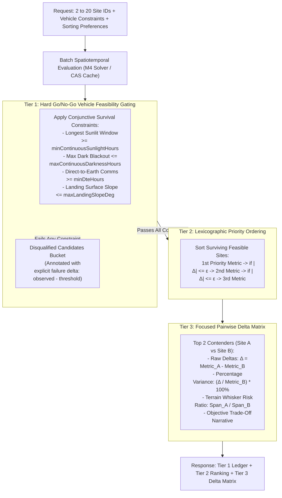
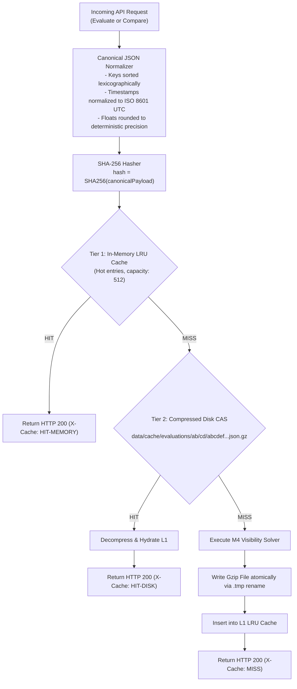

# LunaMission V2: REST API & Integration Contract Specification (`API_CONTRACT.md`)

**Document ID:** `LM-API-P3C-REST-SPEC-2026`  
**Phase:** Gate P3-C (API & Frontend Integration Architecture)  
**Standard:** Enterprise Aerospace Grade / OpenAPI 3.1.0 / JSON Schema Draft 2020-12 / Zod 3.24+ / RFC 7807 / WCAG 2.1 & 2.2 AA Integration  
**Author:** Backend & REST API Architect (Multidisciplinary Product Organization)  
**Approved Baseline:** Aligned with Gate P3-A Research (`USER_RESEARCH.md`), Gate P3-B Specifications (`INFORMATION_ARCHITECTURE.md`, `DESIGN_SYSTEM.md`, `INTERACTION_SPEC.md`), Decisions D-02 & D-03, and Phase 2 M4 Scientific Engine (`visibilitySolver.ts`, `visibilityTypes.ts`, `curated-horizons.json`)  
**Date:** November 2026  

---

## 1. Executive Summary & Golden Architectural Invariants

LunaMission V2 is a deterministic spatiotemporal lunar geometry and horizon-occlusion decision-support platform designed for lunar south-polar landing site analysis ($80^\circ\text{S}–90^\circ\text{S}$). This document establishes the definitive, canonical REST API specification governing the communication between the Hono/NextRush backend (`apps/api`) and the React 19 presentation layer (`apps/web`), as well as external aerospace command clients.

```mermaid
flowchart TD
    subgraph Client ["Frontend Presentation Layer (apps/web)"]
        UI["React 19 Components / Hooks
        (Cockpit Top Bar, 360° Sky-Ribbon, Gantt, Comparison)"]
        ClientCache["TanStack Query (Client CAS Mirror)"]
        RAF_Blitter["Decoupled 60 FPS Canvas Blitter
        (Binary Search over Pre-Partitioned Intervals)"]
    end

    subgraph API_Gateway ["Backend REST Gateway (apps/api)"]
        Router["Hono / NextRush Router (/api/v1/*)"]
        ZodValidator["Zod Schema Interceptor (Strict Validation)"]
        CAS_Service["Content-Addressable Storage (CAS)
        SHA-256 Keyed Disk Cache"]
    end

    subgraph Science_Engine ["Backend Scientific Compute Engine"]
        HorizonsAdapter["NASA JPL Horizons Adapter
        (DE421/DE440 topocentric apparent coord@301)"]
        CuratedHorizons["Curated LOLA Horizon Service
        (360-bin Profiles, 4 Mast Heights [1m, 2m, 5m, 10m])"]
        M4_Solver["M4 Event-Splitting Visibility Solver
        (Cubic Hermite Spline + Rolle Partition + Brent Refinement)"]
        ThreeTier_Pipeline["Three-Tiered Filtering Pipeline
        (Tier 1 Gating -> Tier 2 Lexicographic -> Tier 3 Pairwise)"]
    end

    UI --> ClientCache
    ClientCache -->|HTTPS JSON| Router
    Router --> ZodValidator
    ZodValidator --> CAS_Service
    CAS_Service -->|Cache Hit (304 / 200)| Router
    CAS_Service -->|Cache Miss| M4_Solver
    M4_Solver --> HorizonsAdapter
    M4_Solver --> CuratedHorizons
    Router --> ThreeTier_Pipeline
    ClientCache --> RAF_Blitter
```

### 1.1 The Golden Invariant: Backend Computes, Frontend Renders
1. **100% Scientific Compute Isolation:** All astronomical ephemerides queries, coordinate frame conversions, relativistic time offsets ($\Delta T = \text{TT} - \text{UTC} \approx 69.184\text{ s}$), topocentric horizon lookups, cubic Hermite spline evaluations, Rolle's theorem partition splits, Brent's root refinements ($\le 1.0\text{ s}$), and interval aggregations are performed **exclusively by the backend REST API (`apps/api`)**.
2. **Zero Celestial Math in Frontend:** The browser client (`apps/web`) contains zero orbital math, zero trigonometry for solar angles, zero ray-marching algorithms, and zero hardcoded site coordinates or terrain silhouettes (`Math.sin` procedurals are strictly eliminated).
3. **Deterministic Single Source of Truth:** Every calculation is uniquely identified by a 64-character SHA-256 CAS fingerprint (`calculationId`) computed from canonical JSON serialization of the complete scenario parameters.

### 1.2 Coordinate System & Geodesy Standards
All API payloads strictly adhere to the following astrodynamic conventions:
- **Reference Frame:** Strictly IAU/NASA **`MOON_ME`** (Mean Earth / Polar Axis frame; reference spherical radius $R_{\text{MOON}} = 1,737,400.0\text{ m}$, flattening $f = 0.0$).
- **Longitude Convention:** Strictly **`east_positive_0_360`** ($[0.0^\circ, 360.0^\circ)$ East) in all storage, calculation, and API DTO representations.
- **Latitude Convention:** Planetocentric latitude in degrees ($-90.0^\circ$ to $-80.0^\circ$ for South Pole study domain).
- **Observer Height Reconciliation:** Physical observer radius $r_0 = R_{\text{MOON}} + z_0 + h_{\text{obs}}$, where $z_0$ is surface elevation relative to $1737.4\text{ km}$ and $h_{\text{obs}} \in \{1.0, 2.0, 5.0, 10.0\}\text{ m}$. Altitude parameter for JPL Horizons queries maps to signed kilometers: `horizons_alt_km = (z0 + h_obs) / 1000.0`.
- **Topocentric Ephemeris Conventions:** Airless apparent azimuth and elevation queried from NASA JPL Horizons via `coord@301` with Quantities 4, 5, 13, and 20.

---

## 2. Common Domain Schemas & Enums

All request and response structures are defined via TypeScript types and validated at runtime using Zod schemas.

### 2.1 Epistemic Result Status (`SixStateResultStatus`)
In accordance with `USER_RESEARCH.md` and `AGENTS.md` §3, the API never returns ambiguous boolean passes. Every calculation explicitly declares its epistemic validity state:

```typescript
export const sixStateResultStatusSchema = z.enum([
  'valid',                   // High-resolution DEM, valid ephemeris, benchmark-verified
  'valid-with-limitations',   // Regional DEM or interpolated mast height; valid with noted caveats
  'approximate',             // Bounded uncertainty; coarse temporal sampling or extrapolation
  'incomplete',              // Partial horizon data (e.g. truncated ray) or incomplete window
  'unsupported',             // Coordinate outside DEM coverage or invalid parameter combination
  'failed',                  // Upstream NASA Horizons timeout or unrecoverable calculation error
]);
export type SixStateResultStatus = z.infer<typeof sixStateResultStatusSchema>;
```

### 2.2 Site Taxonomy & Coordinate Reference
```typescript
export const siteEntityTypeEnum = z.enum([
  'candidate_region',           // NASA Artemis III 9 candidate regions (centroid only)
  'research_candidate_point',   // Specific peer-reviewed coordinates (CR01, SP-1)
  'historical_touchdown',       // Soft-landed robotic/crewed missions (Apollo 11, IM-1)
  'negative_control',           // Deep permanently shadowed regions (Shackleton floor)
  'custom_coordinate',          // User-defined coordinates within [80°S, 90°S]
]);
export type SiteEntityType = z.infer<typeof siteEntityTypeEnum>;

export const lunarCoordinatesSchema = z.object({
  latitudeDeg: z.number().min(-90.0).max(-80.0),
  longitudeEastDeg: z.number().min(0.0).max(360.0),
  elevationMeters: z.number(),
  referenceDatum: z.literal('IAU_MOON_ME').default('IAU_MOON_ME'),
  referenceRadiusKm: z.literal(1737.4).default(1737.4),
});
export type LunarCoordinates = z.infer<typeof lunarCoordinatesSchema>;

export const siteInfoSchema = z.object({
  siteId: z.string(),
  siteName: z.string(),
  entityType: siteEntityTypeEnum,
  coordinates: lunarCoordinatesSchema,
  landmark: z.string(),
  dipAngleDeg: z.number(), // Smooth sphere horizon dip: -acos(R_moon / r0)
  officialRegionReference: z.string().optional(),
  provenanceCitations: z.array(z.string()),
});
export type SiteInfo = z.infer<typeof siteInfoSchema>;
```

### 2.3 Scientific Provenance Manifest
Every response contains an uncollapsible cryptographic provenance record:

```typescript
export const provenanceManifestSchema = z.object({
  calculationId: z.string().length(64), // SHA-256 CAS fingerprint
  engineVersion: z.string(),           // e.g. "LunaMission-Engine-2.0.0"
  timestampUtc: z.string().datetime(),
  ephemerisSource: z.literal('NASA_JPL_HORIZONS_API_COORD_301'),
  ephemerisDataset: z.string(),        // e.g. "DE421/DE440"
  timeScaleOffsetTtMinusUtcSec: z.number(), // Strictly 69.184s
  terrainModelSource: z.string(),      // "NASA_LOLA_PDS_LDEM_85S_20M"
  terrainSpatialResolutionM: z.number(), // e.g. 20.0
  horizonProfileAzimuthBins: z.literal(360),
  solverAlgorithm: z.literal('ROLLE_HERMITE_BRENT_EVENT_SPLITTER'),
  rootBracketToleranceSec: z.number(), // <= 1.0s
  tangentialGrazeToleranceDeg: z.number(), // <= 1e-7 deg
  casCacheHit: z.boolean(),
});
export type ProvenanceManifest = z.infer<typeof provenanceManifestSchema>;
```

---

## 3. Endpoint 1: `POST /api/v1/scenarios/evaluate`

Computes the complete, spatiotemporal solar illumination, Earth line-of-sight, operational overlap, and terrain uncertainty for a single lunar landing site over a defined mission epoch.

### 3.1 Mathematical & Operational Specification
1. **Input Normalization & Launch Slip:** The requested mission epoch `[startUtc, stopUtc]` is translated forward by `launchSlipOffsetDays * 86400000 ms`.
2. **Ephemeris Trajectory Query:** Backend queries/fetches topocentric trajectories for Sun (`target='10'`) and Earth (`target='399'`) from NASA JPL Horizons (`coord@301`, Quantities `4,5,13,20`).
3. **Horizon Profile Matching:** Curated 360-bin horizon profile is retrieved for `siteId` at `observerMastHeightM`. If mast height is not an exact precomputed anchor (`1.0, 2.0, 5.0, 10.0`), linear bracket interpolation across adjacent anchors is applied with status `valid-with-limitations`.
4. **M4 Event-Splitting Visibility Solver:**
   - Evaluates continuous cubic Hermite splines constructed from Horizons positions and rates.
   - Partitions time intervals at:
     - Stage A: Extrema of azimuth rate $d\text{Az}/dt = 0$ (Earth libration turnarounds).
     - Stage B: Crossings of $1.0^\circ$ horizon azimuth bin boundaries.
     - Stage C: Real roots of quadratic derivative $dg_B/dt = 0$ (isolates clearance extrema and tangential grazes).
     - Stage D: Exact zero-clearance roots refined via Brent's method ($\delta t \le 1.0\text{ s}$).
5. **Exact Constant-State Subsegment Partition:** Sub-intervals are emitted where solar status, Earth status, and overlap status are constant throughout.
6. **Continuous Solar Disk Fraction $F_{\text{sun}} \in [0.0, 1.0]$:**
   For solar center elevation $El_{\text{sun}}$, solar angular radius $\alpha_{\text{sun}}$, and local horizon elevation $\theta_{\text{mask}}(Az_{\text{sun}})$, signed clearance is $h = El_{\text{sun}} - \theta_{\text{mask}}$. Disk fraction is computed analytically via circular segment area:
   $$F_{\text{sun}} = \begin{cases} 
   0.0 & \text{if } h \le -\alpha_{\text{sun}} \\
   1.0 & \text{if } h \ge +\alpha_{\text{sun}} \\
   \frac{1}{\pi} \left[ \arccos\left(-\frac{h}{\alpha_{\text{sun}}}\right) + \frac{h}{\alpha_{\text{sun}}}\sqrt{1 - \left(\frac{h}{\alpha_{\text{sun}}}\right)^2} \right] & \text{if } -\alpha_{\text{sun}} < h < +\alpha_{\text{sun}}
   \end{cases}$$
7. **Four Solar Operational States:**
   - `full_sun`: $F_{\text{sun}} = 1.0$ and $El_{\text{sun}} > 0.0^\circ$.
   - `partial_limb`: $0.0 < F_{\text{sun}} < 1.0$ (grazing solar limb partially occluded by ridge).
   - `terrain_shadow`: $F_{\text{sun}} = 0.0$ while $El_{\text{sun}} > 0.0^\circ$ (geometric daylight above astronomical horizontal plane, but mountain ridge occludes line-of-sight).
   - `sub_horizon`: $El_{\text{sun}} \le -\alpha_{\text{sun}}$ (Sun is beneath the smooth spherical horizon dip).
8. **Uncertainty Whisker Propagation:** Event boundary times $t^*$ are re-evaluated against the perturbed LOLA horizon bounds $[\theta_{\text{low}}, \theta_{\text{high}}]$, producing timing brackets $[t^*(\theta_{\text{low}}), t^*(\theta_{\text{high}})]$.

### 3.2 Formal Request Schema (OpenAPI 3.1 & Zod)

```typescript
export const scenarioEvaluateRequestSchema = z.object({
  siteId: z.string().min(1, 'siteId is required'),
  startUtc: z.string().datetime({ message: 'startUtc must be a valid ISO 8601 UTC string' }),
  stopUtc: z.string().datetime({ message: 'stopUtc must be a valid ISO 8601 UTC string' }),
  observerMastHeightM: z.union([
    z.literal(1.0),
    z.literal(2.0),
    z.literal(5.0),
    z.literal(10.0),
  ]).default(2.0),
  sunVisibilityCriterion: z.enum(['upperLimb', 'fullDisk']).default('upperLimb'),
  earthVisibilityCriterion: z.enum(['center', 'fullDisk', 'anyLimb']).default('center'),
  launchSlipOffsetDays: z.number().min(0.0).max(28.0).default(0.0),
  sampleIntervalSec: z.number().int().min(60).max(3600).default(600),
}).refine((data) => {
  const start = new Date(data.startUtc).getTime();
  const stop = new Date(data.stopUtc).getTime();
  return stop > start;
}, {
  message: 'stopUtc must be strictly greater than startUtc',
  path: ['stopUtc'],
}).refine((data) => {
  const start = new Date(data.startUtc).getTime();
  const stop = new Date(data.stopUtc).getTime();
  const maxSpanMs = 28 * 86400000; // 28 days max
  return stop - start <= maxSpanMs;
}, {
  message: 'Scenario evaluation window cannot exceed 28 days (672 hours)',
  path: ['stopUtc'],
});

export type ScenarioEvaluateRequest = z.infer<typeof scenarioEvaluateRequestSchema>;
```

#### OpenAPI 3.1 Request Specification (YAML Snippet)
```yaml
post:
  summary: Evaluate Single Site Spatiotemporal Illumination & Visibility
  operationId: evaluateScenario
  tags:
    - Scenarios
  requestBody:
    required: true
    content:
      application/json:
        schema:
          type: object
          required:
            - siteId
            - startUtc
            - stopUtc
          properties:
            siteId:
              type: string
              example: "connecting-ridge"
            startUtc:
              type: string
              format: date-time
              example: "2026-11-01T00:00:00Z"
            stopUtc:
              type: string
              format: date-time
              example: "2026-11-15T00:00:00Z"
            observerMastHeightM:
              type: number
              enum: [1.0, 2.0, 5.0, 10.0]
              default: 2.0
            sunVisibilityCriterion:
              type: string
              enum: ["upperLimb", "fullDisk"]
              default: "upperLimb"
            earthVisibilityCriterion:
              type: string
              enum: ["center", "fullDisk", "anyLimb"]
              default: "center"
            launchSlipOffsetDays:
              type: number
              minimum: 0.0
              maximum: 28.0
              default: 0.0
            sampleIntervalSec:
              type: integer
              minimum: 60
              maximum: 3600
              default: 600
```

### 3.3 Formal Response Schema (OpenAPI 3.1 & Zod)

```typescript
export const solarIntervalStatusEnum = z.enum([
  'full_sun',        // F_sun = 1.0, direct solar irradiance
  'partial_limb',    // 0.0 < F_sun < 1.0, penumbral grazing occultation
  'terrain_shadow',  // F_sun = 0.0, geometric El > 0° but blocked by ridge
  'sub_horizon',     // F_sun = 0.0, solar disk beneath smooth horizon dip
]);
export type SolarIntervalStatus = z.infer<typeof solarIntervalStatusEnum>;

export const earthIntervalStatusEnum = z.enum([
  'visible',          // Direct Earth line-of-sight clears terrain mask
  'terrain_blocked',  // Blocked by local topography
  'sub_horizon',      // Earth disk beneath smooth horizon dip
]);
export type EarthIntervalStatus = z.infer<typeof earthIntervalStatusEnum>;

export const overlapIntervalStatusEnum = z.enum([
  'sun_and_earth',     // Both solar power and DTE communications active
  'sun_only',          // Solar power active; DTE comms blocked or down
  'earth_only',        // DTE comms active; solar blackout (battery discharge)
  'dark_and_blocked',  // Solar blackout and no DTE communications
]);
export type OverlapIntervalStatus = z.infer<typeof overlapIntervalStatusEnum>;

export const blockerMetadataSchema = z.object({
  azimuthDeg: z.number().min(0.0).max(360.0),
  distanceKm: z.number().nonnegative(),
  elevationMeters: z.number(),
  featureName: z.string().optional(),
});
export type BlockerMetadata = z.infer<typeof blockerMetadataSchema>;

export const evaluatedSubIntervalSchema = z.object({
  startEpochMs: z.number(),
  endEpochMs: z.number(),
  startDateUtc: z.string().datetime(),
  endDateUtc: z.string().datetime(),
  durationHours: z.number().nonnegative(),
  sun: z.object({
    status: solarIntervalStatusEnum,
    fractionalSolarDiskVisibility: z.number().min(0.0).max(1.0),
    meanElevationDeg: z.number(),
    meanAzimuthDeg: z.number(),
    meanHorizonMaskDeg: z.number(),
    clearanceDeg: z.number(),
    blocker: blockerMetadataSchema.nullable(),
  }),
  earth: z.object({
    status: earthIntervalStatusEnum,
    meanElevationDeg: z.number(),
    meanAzimuthDeg: z.number(),
    meanHorizonMaskDeg: z.number(),
    clearanceDeg: z.number(),
  }),
  overlap: z.object({
    status: overlapIntervalStatusEnum,
    isMissionCriticalWindow: z.boolean(), // true if full_sun AND visible
  }),
});
export type EvaluatedSubInterval = z.infer<typeof evaluatedSubIntervalSchema>;

export const summaryMetricsSchema = z.object({
  totalEvaluationHours: z.number().positive(),
  cumulativeSunlitHours: z.number().nonnegative(),
  solarAccessPercentage: z.number().min(0.0).max(100.0),
  longestContinuousSunlitWindowHours: z.number().nonnegative(),
  longestContinuousDarkWindowHours: z.number().nonnegative(),
  cumulativeDteHours: z.number().nonnegative(),
  dteAccessPercentage: z.number().min(0.0).max(100.0),
  longestDteGapHours: z.number().nonnegative(),
  cumulativeOverlapHours: z.number().nonnegative(),
  overlapPercentage: z.number().min(0.0).max(100.0),
  topographicShadowPenaltyHours: z.number().nonnegative(), // Hours lost to terrain ridges
});
export type SummaryMetrics = z.infer<typeof summaryMetricsSchema>;

export const eventWhiskerSchema = z.object({
  eventEpochMs: z.number(),
  eventDateUtc: z.string().datetime(),
  eventType: z.enum(['SUNRISE', 'SUNSET', 'EARTH_RISE', 'EARTH_SET']),
  azimuthDeg: z.number(),
  tLowDateUtc: z.string().datetime(),
  tNominalDateUtc: z.string().datetime(),
  tHighDateUtc: z.string().datetime(),
  whiskerSpanHours: z.number().nonnegative(),
  sensitivityRating: z.enum(['LOW', 'MODERATE', 'HIGH']),
});
export type EventWhisker = z.infer<typeof eventWhiskerSchema>;

export const uncertaintyEnvelopeSchema = z.object({
  nominalMetrics: summaryMetricsSchema,
  thetaLowMetrics: summaryMetricsSchema,
  thetaHighMetrics: summaryMetricsSchema,
  eventWhiskers: z.array(eventWhiskerSchema),
});
export type UncertaintyEnvelope = z.infer<typeof uncertaintyEnvelopeSchema>;

export const scenarioEvaluateResponseSchema = z.object({
  calculationId: z.string().length(64),
  status: sixStateResultStatusSchema,
  siteInfo: siteInfoSchema,
  scenarioConfig: z.object({
    requestedStartUtc: z.string().datetime(),
    requestedStopUtc: z.string().datetime(),
    effectiveStartUtc: z.string().datetime(),
    effectiveStopUtc: z.string().datetime(),
    launchSlipOffsetDays: z.number(),
    observerMastHeightM: z.number(),
    sunVisibilityCriterion: z.enum(['upperLimb', 'fullDisk']),
    earthVisibilityCriterion: z.enum(['center', 'fullDisk', 'anyLimb']),
    sampleIntervalSec: z.number(),
  }),
  metrics: summaryMetricsSchema,
  intervals: z.array(evaluatedSubIntervalSchema),
  uncertaintyEnvelopes: uncertaintyEnvelopeSchema,
  provenance: provenanceManifestSchema,
});
export type ScenarioEvaluateResponse = z.infer<typeof scenarioEvaluateResponseSchema>;
```

### 3.4 Concrete Payload Example (`evaluate`)

#### Request Example:
```json
{
  "siteId": "connecting-ridge",
  "startUtc": "2026-11-01T00:00:00Z",
  "stopUtc": "2026-11-15T00:00:00Z",
  "observerMastHeightM": 2.0,
  "sunVisibilityCriterion": "upperLimb",
  "earthVisibilityCriterion": "center",
  "launchSlipOffsetDays": 0.0,
  "sampleIntervalSec": 600
}
```

#### Response Example:
```json
{
  "calculationId": "e3b0c44298fc1c149afbf4c8996fb92427ae41e4649b934ca495991b7852b855",
  "status": "valid",
  "siteInfo": {
    "siteId": "connecting-ridge",
    "siteName": "Connecting Ridge (Point CR01)",
    "entityType": "research_candidate_point",
    "coordinates": {
      "latitudeDeg": -89.5270,
      "longitudeEastDeg": 205.4080,
      "elevationMeters": 2085.0,
      "referenceDatum": "IAU_MOON_ME",
      "referenceRadiusKm": 1737.4
    },
    "landmark": "Connecting Ridge between Shackleton and de Gerlache craters",
    "dipAngleDeg": -0.091,
    "officialRegionReference": "Connecting Ridge Region (Artemis III)",
    "provenanceCitations": ["Wueller et al. (2026)", "NASA Artemis III Candidate Regions (2022)"]
  },
  "scenarioConfig": {
    "requestedStartUtc": "2026-11-01T00:00:00.000Z",
    "requestedStopUtc": "2026-11-15T00:00:00.000Z",
    "effectiveStartUtc": "2026-11-01T00:00:00.000Z",
    "effectiveStopUtc": "2026-11-15T00:00:00.000Z",
    "launchSlipOffsetDays": 0.0,
    "observerMastHeightM": 2.0,
    "sunVisibilityCriterion": "upperLimb",
    "earthVisibilityCriterion": "center",
    "sampleIntervalSec": 600
  },
  "metrics": {
    "totalEvaluationHours": 336.0,
    "cumulativeSunlitHours": 214.32,
    "solarAccessPercentage": 63.79,
    "longestContinuousSunlitWindowHours": 182.50,
    "longestContinuousDarkWindowHours": 14.20,
    "cumulativeDteHours": 198.05,
    "dteAccessPercentage": 58.94,
    "longestDteGapHours": 42.10,
    "cumulativeOverlapHours": 164.50,
    "overlapPercentage": 48.96,
    "topographicShadowPenaltyHours": 48.25
  },
  "intervals": [
    {
      "startEpochMs": 1793491200000,
      "endEpochMs": 1793548200000,
      "startDateUtc": "2026-11-01T00:00:00.000Z",
      "endDateUtc": "2026-11-01T15:50:00.000Z",
      "durationHours": 15.833,
      "sun": {
        "status": "full_sun",
        "fractionalSolarDiskVisibility": 1.0,
        "meanElevationDeg": 1.25,
        "meanAzimuthDeg": 154.2,
        "meanHorizonMaskDeg": 0.42,
        "clearanceDeg": 0.83,
        "blocker": null
      },
      "earth": {
        "status": "visible",
        "meanElevationDeg": 8.42,
        "meanAzimuthDeg": 342.1,
        "meanHorizonMaskDeg": 0.38,
        "clearanceDeg": 8.04
      },
      "overlap": {
        "status": "sun_and_earth",
        "isMissionCriticalWindow": true
      }
    },
    {
      "startEpochMs": 1793548200000,
      "endEpochMs": 1793551800000,
      "startDateUtc": "2026-11-01T15:50:00.000Z",
      "endDateUtc": "2026-11-01T16:50:00.000Z",
      "durationHours": 1.000,
      "sun": {
        "status": "partial_limb",
        "fractionalSolarDiskVisibility": 0.42,
        "meanElevationDeg": 0.45,
        "meanAzimuthDeg": 162.0,
        "meanHorizonMaskDeg": 0.44,
        "clearanceDeg": 0.01,
        "blocker": {
          "azimuthDeg": 162.0,
          "distanceKm": 48.2,
          "elevationMeters": 2420.0,
          "featureName": "Connecting Ridge Western Shoulder"
        }
      },
      "earth": {
        "status": "visible",
        "meanElevationDeg": 8.35,
        "meanAzimuthDeg": 342.5,
        "meanHorizonMaskDeg": 0.39,
        "clearanceDeg": 7.96
      },
      "overlap": {
        "status": "sun_and_earth",
        "isMissionCriticalWindow": false
      }
    }
  ],
  "uncertaintyEnvelopes": {
    "nominalMetrics": {
      "totalEvaluationHours": 336.0,
      "cumulativeSunlitHours": 214.32,
      "solarAccessPercentage": 63.79,
      "longestContinuousSunlitWindowHours": 182.50,
      "longestContinuousDarkWindowHours": 14.20,
      "cumulativeDteHours": 198.05,
      "dteAccessPercentage": 58.94,
      "longestDteGapHours": 42.10,
      "cumulativeOverlapHours": 164.50,
      "overlapPercentage": 48.96,
      "topographicShadowPenaltyHours": 48.25
    },
    "thetaLowMetrics": {
      "totalEvaluationHours": 336.0,
      "cumulativeSunlitHours": 222.10,
      "solarAccessPercentage": 66.10,
      "longestContinuousSunlitWindowHours": 188.00,
      "longestContinuousDarkWindowHours": 12.10,
      "cumulativeDteHours": 201.20,
      "dteAccessPercentage": 59.88,
      "longestDteGapHours": 39.50,
      "cumulativeOverlapHours": 171.20,
      "overlapPercentage": 50.95,
      "topographicShadowPenaltyHours": 42.10
    },
    "thetaHighMetrics": {
      "totalEvaluationHours": 336.0,
      "cumulativeSunlitHours": 205.80,
      "solarAccessPercentage": 61.25,
      "longestContinuousSunlitWindowHours": 176.20,
      "longestContinuousDarkWindowHours": 16.50,
      "cumulativeDteHours": 194.80,
      "dteAccessPercentage": 57.98,
      "longestDteGapHours": 45.20,
      "cumulativeOverlapHours": 158.40,
      "overlapPercentage": 47.14,
      "topographicShadowPenaltyHours": 54.10
    },
    "eventWhiskers": [
      {
        "eventEpochMs": 1793551800000,
        "eventDateUtc": "2026-11-01T16:50:00.000Z",
        "eventType": "SUNSET",
        "azimuthDeg": 162.5,
        "tLowDateUtc": "2026-11-01T17:42:00.000Z",
        "tNominalDateUtc": "2026-11-01T16:50:00.000Z",
        "tHighDateUtc": "2026-11-01T15:58:00.000Z",
        "whiskerSpanHours": 1.733,
        "sensitivityRating": "LOW"
      }
    ]
  },
  "provenance": {
    "calculationId": "e3b0c44298fc1c149afbf4c8996fb92427ae41e4649b934ca495991b7852b855",
    "engineVersion": "LunaMission-Engine-2.0.0",
    "timestampUtc": "2026-11-05T01:45:00.000Z",
    "ephemerisSource": "NASA_JPL_HORIZONS_API_COORD_301",
    "ephemerisDataset": "DE421/DE440",
    "timeScaleOffsetTtMinusUtcSec": 69.184,
    "terrainModelSource": "NASA_LOLA_PDS_LDEM_85S_20M",
    "terrainSpatialResolutionM": 20.0,
    "horizonProfileAzimuthBins": 360,
    "solverAlgorithm": "ROLLE_HERMITE_BRENT_EVENT_SPLITTER",
    "rootBracketToleranceSec": 1.0,
    "tangentialGrazeToleranceDeg": 1e-7,
    "casCacheHit": true
  }
}
```

---

## 4. Endpoint 2: `POST /api/v1/scenarios/compare`

Computes a multi-site comparative evaluation across 2 to 20 candidate landing sites for a synchronized mission epoch.

### 4.1 Rejection of Composite Scores (Decisions D-02 & D-03)
In strict alignment with `USER_RESEARCH.md` and `INFORMATION_ARCHITECTURE.md` §5:
- **Zero Arbitrary Composite Indexes:** The API **strictly rejects TOPSIS**, weighted linear combination (WLC), and single scalar viability scores. A site with a catastrophic 30-hour battery freeze cannot barter for life with high average sunlight.
- **Three-Tiered Filtering Pipeline:**
  1. **Tier 1 (Hard Go/No-Go Gating):** Non-compensatory vehicle engineering thresholds cull unviable candidates. Disqualified sites are retained in the response with exact physical failure margins.
  2. **Tier 2 (Lexicographic Ordering):** Surviving feasible candidates are ordered by operator-selected mission priority metrics with epsilon-band tie-breaking.
  3. **Tier 3 (Focused Pairwise Delta Matrix):** Top contenders are contrasted across physical deltas ($A - B$), relative variances ($\%$), terrain uncertainty whisker spans, and an objective, synthesized trade-off narrative.



### 4.2 Formal Request Schema (OpenAPI 3.1 & Zod)

```typescript
export const vehicleConstraintsSchema = z.object({
  minContinuousSunlightHours: z.number().min(0.0).max(672.0).default(120.0),
  maxContinuousDarknessHours: z.number().min(0.0).max(672.0).default(16.0),
  minDteHours: z.number().min(0.0).max(672.0).default(80.0),
  maxLandingSlopeDeg: z.number().min(0.0).max(45.0).default(10.0),
});
export type VehicleConstraints = z.infer<typeof vehicleConstraintsSchema>;

export const sortMetricKeyEnum = z.enum([
  'longestContinuousSunlight',
  'maxContinuousDarkness',
  'cumulativeDteHours',
  'cumulativeOverlapHours',
  'cumulativeSunlight',
  'maxLandingSlope',
  'terrainUncertaintySpan',
]);
export type SortMetricKey = z.infer<typeof sortMetricKeyEnum>;

export const scenarioCompareRequestSchema = z.object({
  siteIds: z.array(z.string().min(1)).min(2, 'At least 2 sites required for comparison').max(20, 'Maximum 20 sites allowed'),
  startUtc: z.string().datetime(),
  stopUtc: z.string().datetime(),
  observerMastHeightM: z.union([
    z.literal(1.0),
    z.literal(2.0),
    z.literal(5.0),
    z.literal(10.0),
  ]).default(2.0),
  sunVisibilityCriterion: z.enum(['upperLimb', 'fullDisk']).default('upperLimb'),
  earthVisibilityCriterion: z.enum(['center', 'fullDisk', 'anyLimb']).default('center'),
  launchSlipOffsetDays: z.number().min(0.0).max(28.0).default(0.0),
  vehicleConstraints: vehicleConstraintsSchema.default({
    minContinuousSunlightHours: 120.0,
    maxContinuousDarknessHours: 16.0,
    minDteHours: 80.0,
    maxLandingSlopeDeg: 10.0,
  }),
  rankingPreferences: z.object({
    primarySortMetric: sortMetricKeyEnum.default('longestContinuousSunlight'),
    secondarySortMetric: sortMetricKeyEnum.default('maxContinuousDarkness'),
    tertiarySortMetric: sortMetricKeyEnum.default('cumulativeOverlapHours'),
    tieToleranceHours: z.number().min(0.0).max(24.0).default(2.0),
  }).default({
    primarySortMetric: 'longestContinuousSunlight',
    secondarySortMetric: 'maxContinuousDarkness',
    tertiarySortMetric: 'cumulativeOverlapHours',
    tieToleranceHours: 2.0,
  }),
  pairwiseSelection: z.object({
    siteIdA: z.string().optional(),
    siteIdB: z.string().optional(),
  }).optional(),
});
export type ScenarioCompareRequest = z.infer<typeof scenarioCompareRequestSchema>;
```

### 4.3 Formal Response Schema (OpenAPI 3.1 & Zod)

```typescript
export const rejectionReasonSchema = z.object({
  constraintName: z.enum(['minContinuousSunlight', 'maxContinuousDarkness', 'minDte', 'maxLandingSlope']),
  thresholdValue: z.number(),
  observedValue: z.number(),
  unit: z.string(),
  marginOfFailure: z.number(), // Positive delta indicating degree of violation
  narrative: z.string(),
});
export type RejectionReason = z.infer<typeof rejectionReasonSchema>;

export const disqualifiedCandidateSchema = z.object({
  siteId: z.string(),
  siteName: z.string(),
  entityType: siteEntityTypeEnum,
  rejectionReasons: z.array(rejectionReasonSchema),
});
export type DisqualifiedCandidate = z.infer<typeof disqualifiedCandidateSchema>;

export const rankedFeasibleCandidateSchema = z.object({
  rank: z.number().int().positive(),
  siteId: z.string(),
  siteName: z.string(),
  entityType: siteEntityTypeEnum,
  coordinates: lunarCoordinatesSchema,
  metrics: z.object({
    longestContinuousSunlightHours: z.number(),
    maxContinuousDarknessHours: z.number(),
    cumulativeSunlitHours: z.number(),
    solarAccessPercentage: z.number(),
    cumulativeDteHours: z.number(),
    dteAccessPercentage: z.number(),
    cumulativeOverlapHours: z.number(),
    landingSlopeDeg: z.number(),
    terrainUncertaintySpanHours: z.number(),
  }),
  sortKeyTrace: z.array(z.object({
    metric: sortMetricKeyEnum,
    value: z.number(),
    tieBroken: z.boolean(),
  })),
});
export type RankedFeasibleCandidate = z.infer<typeof rankedFeasibleCandidateSchema>;

export const pairwiseDeltaItemSchema = z.object({
  metricKey: z.string(),
  metricLabel: z.string(),
  unit: z.string(),
  valueA: z.number(),
  valueB: z.number(),
  absoluteDelta: z.number(), // valueA - valueB
  percentDelta: z.number(),   // ((valueA - valueB) / valueB) * 100
  favoredSite: z.enum(['siteA', 'siteB', 'tie']),
  operationalSignificance: z.string(),
});
export type PairwiseDeltaItem = z.infer<typeof pairwiseDeltaItemSchema>;

export const tier3PairwiseDeltaSchema = z.object({
  siteA: z.object({ siteId: string, siteName: string }),
  siteB: z.object({ siteId: string, siteName: string }),
  deltas: z.array(pairwiseDeltaItemSchema),
  terrainSensitivityComparison: z.object({
    uncertaintySpanHoursA: z.number(),
    uncertaintySpanHoursB: z.number(),
    whiskerRatio: z.number(), // Ratio of uncertainty spans
    lowerRiskSite: z.enum(['siteA', 'siteB', 'tie']),
  }),
  objectiveTradeOffNarrative: z.string(),
});
export type Tier3PairwiseDelta = z.infer<typeof tier3PairwiseDeltaSchema>;

export const scenarioCompareResponseSchema = z.object({
  calculationId: z.string().length(64),
  status: sixStateResultStatusSchema,
  scenarioConfig: z.object({
    startUtc: z.string().datetime(),
    stopUtc: z.string().datetime(),
    totalEvaluationHours: z.number(),
    launchSlipOffsetDays: z.number(),
    observerMastHeightM: z.number(),
    sunVisibilityCriterion: z.enum(['upperLimb', 'fullDisk']),
    earthVisibilityCriterion: z.enum(['center', 'fullDisk', 'anyLimb']),
  }),
  tier1Gating: z.object({
    totalEvaluatedSites: z.number().int(),
    feasibleSitesCount: z.number().int(),
    disqualifiedSitesCount: z.number().int(),
    feasibleSiteIds: z.array(z.string()),
    disqualifiedCandidates: z.array(disqualifiedCandidateSchema),
  }),
  tier2Ranking: z.object({
    priorityHierarchy: z.array(sortMetricKeyEnum),
    rankedCandidates: z.array(rankedFeasibleCandidateSchema),
  }),
  tier3Pairwise: tier3PairwiseDeltaSchema.nullable(),
  provenance: provenanceManifestSchema,
});
export type ScenarioCompareResponse = z.infer<typeof scenarioCompareResponseSchema>;
```

### 4.4 Concrete Payload Example (`compare`)

#### Request Example:
```json
{
  "siteIds": ["connecting-ridge", "peak-near-shackleton", "malapert-massif", "amundsen-rim"],
  "startUtc": "2026-11-01T00:00:00Z",
  "stopUtc": "2026-11-15T00:00:00Z",
  "observerMastHeightM": 2.0,
  "vehicleConstraints": {
    "minContinuousSunlightHours": 120.0,
    "maxContinuousDarknessHours": 16.0,
    "minDteHours": 80.0,
    "maxLandingSlopeDeg": 10.0
  },
  "rankingPreferences": {
    "primarySortMetric": "longestContinuousSunlight",
    "secondarySortMetric": "maxContinuousDarkness",
    "tertiarySortMetric": "cumulativeOverlapHours",
    "tieToleranceHours": 2.0
  }
}
```

#### Response Example:
```json
{
  "calculationId": "9f83ac64b7324c159828e6c71c4c925828ae41e4649b934ca495991b7852a104",
  "status": "valid",
  "scenarioConfig": {
    "startUtc": "2026-11-01T00:00:00.000Z",
    "stopUtc": "2026-11-15T00:00:00.000Z",
    "totalEvaluationHours": 336.0,
    "launchSlipOffsetDays": 0.0,
    "observerMastHeightM": 2.0,
    "sunVisibilityCriterion": "upperLimb",
    "earthVisibilityCriterion": "center"
  },
  "tier1Gating": {
    "totalEvaluatedSites": 4,
    "feasibleSitesCount": 2,
    "disqualifiedSitesCount": 2,
    "feasibleSiteIds": ["connecting-ridge", "peak-near-shackleton"],
    "disqualifiedCandidates": [
      {
        "siteId": "malapert-massif",
        "siteName": "Malapert Massif Centroid",
        "entityType": "candidate_region",
        "rejectionReasons": [
          {
            "constraintName": "maxContinuousDarkness",
            "thresholdValue": 16.0,
            "observedValue": 38.2,
            "unit": "hours",
            "marginOfFailure": 22.2,
            "narrative": "Max continuous darkness (38.2 h) exceeds vehicle battery reserve threshold (16.0 h) by 22.2 h."
          }
        ]
      },
      {
        "siteId": "amundsen-rim",
        "siteName": "Amundsen Crater Rim Point",
        "entityType": "research_candidate_point",
        "rejectionReasons": [
          {
            "constraintName": "minDte",
            "thresholdValue": 80.0,
            "observedValue": 54.1,
            "unit": "hours",
            "marginOfFailure": 25.9,
            "narrative": "Direct-to-Earth communication duration (54.1 h) falls 25.9 h short of mission telemetry threshold (80.0 h)."
          }
        ]
      }
    ]
  },
  "tier2Ranking": {
    "priorityHierarchy": [
      "longestContinuousSunlight",
      "maxContinuousDarkness",
      "cumulativeOverlapHours"
    ],
    "rankedCandidates": [
      {
        "rank": 1,
        "siteId": "connecting-ridge",
        "siteName": "Connecting Ridge (Point CR01)",
        "entityType": "research_candidate_point",
        "coordinates": {
          "latitudeDeg": -89.5270,
          "longitudeEastDeg": 205.4080,
          "elevationMeters": 2085.0,
          "referenceDatum": "IAU_MOON_ME",
          "referenceRadiusKm": 1737.4
        },
        "metrics": {
          "longestContinuousSunlightHours": 182.5,
          "maxContinuousDarknessHours": 14.2,
          "cumulativeSunlitHours": 214.3,
          "solarAccessPercentage": 63.8,
          "cumulativeDteHours": 198.0,
          "dteAccessPercentage": 58.9,
          "cumulativeOverlapHours": 164.5,
          "landingSlopeDeg": 6.8,
          "terrainUncertaintySpanHours": 3.2
        },
        "sortKeyTrace": [
          { "metric": "longestContinuousSunlight", "value": 182.5, "tieBroken": false }
        ]
      },
      {
        "rank": 2,
        "siteId": "peak-near-shackleton",
        "siteName": "Peak Near Shackleton (Peak SP-1)",
        "entityType": "research_candidate_point",
        "coordinates": {
          "latitudeDeg": -89.4500,
          "longitudeEastDeg": 222.6900,
          "elevationMeters": 2150.0,
          "referenceDatum": "IAU_MOON_ME",
          "referenceRadiusKm": 1737.4
        },
        "metrics": {
          "longestContinuousSunlightHours": 164.0,
          "maxContinuousDarknessHours": 15.8,
          "cumulativeSunlitHours": 205.1,
          "solarAccessPercentage": 61.0,
          "cumulativeDteHours": 210.5,
          "dteAccessPercentage": 62.6,
          "cumulativeOverlapHours": 152.0,
          "landingSlopeDeg": 8.4,
          "terrainUncertaintySpanHours": 6.8
        },
        "sortKeyTrace": [
          { "metric": "longestContinuousSunlight", "value": 164.0, "tieBroken": false }
        ]
      }
    ]
  },
  "tier3Pairwise": {
    "siteA": {
      "siteId": "connecting-ridge",
      "siteName": "Connecting Ridge (Point CR01)"
    },
    "siteB": {
      "siteId": "peak-near-shackleton",
      "siteName": "Peak Near Shackleton (Peak SP-1)"
    },
    "deltas": [
      {
        "metricKey": "longestContinuousSunlight",
        "metricLabel": "Longest Continuous Sunlight",
        "unit": "hours",
        "valueA": 182.5,
        "valueB": 164.0,
        "absoluteDelta": 18.5,
        "percentDelta": 11.28,
        "favoredSite": "siteA",
        "operationalSignificance": "Site A provides +18.5 h (+11.3%) longer uninterrupted surface mission operations."
      },
      {
        "metricKey": "maxContinuousDarkness",
        "metricLabel": "Maximum Continuous Darkness",
        "unit": "hours",
        "valueA": 14.2,
        "valueB": 15.8,
        "absoluteDelta": -1.6,
        "percentDelta": -10.13,
        "favoredSite": "siteA",
        "operationalSignificance": "Site A reduces maximum battery cold-soak duration by 1.6 h."
      },
      {
        "metricKey": "cumulativeDteHours",
        "metricLabel": "Direct-to-Earth (DTE) Comms",
        "unit": "hours",
        "valueA": 198.0,
        "valueB": 210.5,
        "absoluteDelta": -12.5,
        "percentDelta": -5.94,
        "favoredSite": "siteB",
        "operationalSignificance": "Site B provides +12.5 h (+6.3%) additional high-rate Earth line-of-sight."
      },
      {
        "metricKey": "cumulativeOverlapHours",
        "metricLabel": "Combined Sun & Earth Overlap",
        "unit": "hours",
        "valueA": 164.5,
        "valueB": 152.0,
        "absoluteDelta": 12.5,
        "percentDelta": 8.22,
        "favoredSite": "siteA",
        "operationalSignificance": "Site A provides +12.5 h more concurrent power and communications."
      }
    ],
    "terrainSensitivityComparison": {
      "uncertaintySpanHoursA": 3.2,
      "uncertaintySpanHoursB": 6.8,
      "whiskerRatio": 2.125,
      "lowerRiskSite": "siteA"
    },
    "objectiveTradeOffNarrative": "Connecting Ridge (Point CR01) provides 18.5 hours more continuous illumination and a 2.1x narrower terrain sensitivity bracket (3.2 h vs 6.8 h), while Peak Near Shackleton (Peak SP-1) provides 12.5 additional hours of Direct-to-Earth communication."
  },
  "provenance": {
    "calculationId": "9f83ac64b7324c159828e6c71c4c925828ae41e4649b934ca495991b7852a104",
    "engineVersion": "LunaMission-Engine-2.0.0",
    "timestampUtc": "2026-11-05T01:45:00.000Z",
    "ephemerisSource": "NASA_JPL_HORIZONS_API_COORD_301",
    "ephemerisDataset": "DE421/DE440",
    "timeScaleOffsetTtMinusUtcSec": 69.184,
    "terrainModelSource": "NASA_LOLA_PDS_LDEM_85S_20M",
    "terrainSpatialResolutionM": 20.0,
    "horizonProfileAzimuthBins": 360,
    "solverAlgorithm": "ROLLE_HERMITE_BRENT_EVENT_SPLITTER",
    "rootBracketToleranceSec": 1.0,
    "tangentialGrazeToleranceDeg": 1e-7,
    "casCacheHit": true
  }
}
```

---

## 5. Content-Addressable Storage (CAS) Disk Caching Strategy

The scientific calculations performed by LunaMission V2 are strictly deterministic functions of input parameters and static NASA planetary datasets. To guarantee sub-10ms response times for recurring queries, eliminate redundant JPL Horizons API calls, and support reproducible mission audits, the backend implements a **Two-Tier Content-Addressable Storage (CAS)** architecture.



### 5.1 Canonical Serialization & Fingerprint Derivation
To prevent cosmetic variations in JSON key order or float formatting from generating divergent cache keys, requests are normalized through a canonical serializer:
1. **Key Lexicographical Sorting:** All JSON object keys are recursively sorted in ascending ASCII order.
2. **Numeric Canonicalization:**
   - Float coordinates (`latitudeDeg`, `longitudeEastDeg`) rounded to 6 decimal places ($0.000001^\circ \approx 3\text{ cm}$).
   - Elevation rounded to 1 decimal place ($0.1\text{ m}$).
   - Mast heights clamped to standard anchors (`1.0`, `2.0`, `5.0`, `10.0`).
3. **Temporal UTC Normalization:** All dates normalized to `YYYY-MM-DDTHH:mm:ss.000Z`.

#### Formal Hash Specification:
```typescript
export function computeScenarioHash(params: ScenarioEvaluateRequest): string {
  const canonical = {
    earthVisibilityCriterion: params.earthVisibilityCriterion,
    launchSlipOffsetDays: Number(params.launchSlipOffsetDays.toFixed(3)),
    observerMastHeightM: Number(params.observerMastHeightM.toFixed(1)),
    sampleIntervalSec: params.sampleIntervalSec,
    siteId: params.siteId.trim().toLowerCase(),
    startUtc: new Date(params.startUtc).toISOString(),
    stopUtc: new Date(params.stopUtc).toISOString(),
    sunVisibilityCriterion: params.sunVisibilityCriterion,
  };
  return createHash('sha256').update(JSON.stringify(canonical)).digest('hex');
}
```

### 5.2 Storage Topology & Atomic Write Protocol
Disk cache files are organized into a two-level sharded directory structure to avoid filesystem directory entry limits:
```
data/cache/
└── evaluations/
    ├── e3/
    │   └── b0/
    │       └── e3b0c44298fc1c149afbf4c8996fb92427ae41e4649b934ca495991b7852b855.json.gz
```

- **Atomic File Writing:** Write payloads to a temporary file in `data/cache/tmp/` and execute `fs.renameSync()` to guarantee zero partial-read corruption during concurrent access.
- **Compression:** All disk artifacts are compressed with `gzip` (`level: 6`), reducing a 336-hour interval payload from $\sim 140\text{ KB}$ to $< 18\text{ KB}$.

### 5.3 Cache Headers & Client Invalidation Contract
Responses include explicit HTTP caching and diagnostic headers:
- `ETag: "e3b0c44298fc1c149afbf4c8996fb92427ae41e4649b934ca495991b7852b855"`
- `X-Calculation-Id: "e3b0c44298fc1c149afbf4c8996fb92427ae41e4649b934ca495991b7852b855"`
- `X-Cache: HIT-MEMORY | HIT-DISK | MISS`
- `Cache-Control: public, max-age=86400, stale-while-revalidate=604800`

If the client sends `If-None-Match: "<calculationId>"`, the server responds with **HTTP 304 Not Modified** (zero payload bytes).

---

## 6. Deterministic Error Architecture (RFC 7807)

LunaMission V2 enforces strict RFC 7807 Problem Details compliant error responses. The API never returns generic `500 Internal Server Error` strings or ambiguous JSON bodies.

### 6.1 RFC 7807 Error Response Schema

```typescript
export const apiErrorResponseSchema = z.object({
  type: z.string().url(),              // e.g. "https://lunamission.nasa.gov/errors/E_SITE_NOT_FOUND"
  title: z.string(),                  // Human-readable summary
  status: z.number().int(),           // HTTP status code (400, 404, 422, 502, 504)
  code: z.enum([
    'E_VALIDATION_ERROR',
    'E_SITE_NOT_FOUND',
    'E_INVALID_DATE_RANGE',
    'E_WINDOW_EXCEEDS_MAX',
    'E_UNSUPPORTED_MAST_HEIGHT',
    'E_TERRAIN_TRUNCATED',
    'E_EPHEMERIS_UNAVAILABLE',
    'E_INSUFFICIENT_SITES',
    'E_TOO_MANY_SITES',
    'E_RATE_LIMIT_EXCEEDED',
  ]),
  detail: z.string(),                 // Detailed diagnostic explanation
  instance: z.string(),               // Request URI that generated the error
  invalidParams: z.array(z.object({
    name: z.string(),
    reason: z.string(),
  })).optional(),
  remediation: z.string(),            // Actionable advice for the operator
  timestampUtc: z.string().datetime(),
});
export type ApiErrorResponse = z.infer<typeof apiErrorResponseSchema>;
```

### 6.2 Deterministic Error Code Catalog

| Error Code | HTTP Status | Description & Failure Cause | Remediation Hint |
| :--- | :--- | :--- | :--- |
| `E_VALIDATION_ERROR` | 400 Bad Request | Request payload violated Zod validation schemas (e.g. malformed ISO string, out-of-range value). | Inspect `invalidParams` array and correct payload types. |
| `E_SITE_NOT_FOUND` | 404 Not Found | Requested `siteId` is not present in `data/sites-registry.json` or `curated-horizons.json`. | Query `GET /api/v1/sites` to retrieve the registered 20 candidate site IDs. |
| `E_INVALID_DATE_RANGE` | 422 Unprocessable | `stopUtc` is prior to or identical to `startUtc`, or epoch is outside valid Horizons DE421 bounds ($1900–2050$). | Verify temporal bounds: `startUtc` must precede `stopUtc`. |
| `E_WINDOW_EXCEEDS_MAX` | 422 Unprocessable | Requested duration exceeds the maximum allowable single-run window ($28\text{ days} / 672\text{ hours}$). | Partition evaluation into sequential windows of $\le 28$ days. |
| `E_UNSUPPORTED_MAST_HEIGHT` | 422 Unprocessable | Mast height is outside allowed range $[1.0\text{ m}, 10.0\text{ m}]$, or bracket interpolation failed. | Use supported anchor mast heights: `1.0`, `2.0`, `5.0`, or `10.0` meters. |
| `E_TERRAIN_TRUNCATED` | 500 Server Error | Geodesic ray exited DEM footprint prior to reaching $s_{\text{bound}}$ stopping limit; horizon incomplete. | Flagged site requires nested DEM handoff from `LDEM_85S_20M` to `LDEM_80S_60M`. |
| `E_EPHEMERIS_UNAVAILABLE` | 502 Bad Gateway | NASA JPL Horizons API (`coord@301`) timed out, returned non-200 status, or emitted malformed header line. | Upstream NASA Horizons service degraded. Retry using cached historical epochs. |
| `E_INSUFFICIENT_SITES` | 400 Bad Request | `siteIds` array in comparison request contains fewer than 2 distinct site IDs. | Provide between 2 and 20 site IDs in the `siteIds` array. |
| `E_TOO_MANY_SITES` | 400 Bad Request | `siteIds` array contains more than 20 candidate sites. | Limit comparison cohort to 20 candidate sites per request. |

### 6.3 Concrete Error Payload Example
```json
{
  "type": "https://lunamission.nasa.gov/errors/E_UNSUPPORTED_MAST_HEIGHT",
  "title": "Unsupported Observer Mast Height",
  "status": 422,
  "code": "E_UNSUPPORTED_MAST_HEIGHT",
  "detail": "Requested observer mast height 25.0m exceeds the maximum precomputed LOLA terrain anchor (10.0m).",
  "instance": "/api/v1/scenarios/evaluate",
  "invalidParams": [
    {
      "name": "observerMastHeightM",
      "reason": "Value must be one of [1.0, 2.0, 5.0, 10.0] meters."
    }
  ],
  "remediation": "Select one of the validated mast height anchors: 1.0m (lander deck), 2.0m (nominal mast), 5.0m (tall mast), or 10.0m (tower).",
  "timestampUtc": "2026-11-05T01:45:00.000Z"
}
```

---

## 7. Client Consumption & Integration Architecture (`apps/web`)

### 7.1 High-Velocity Scrubbing via $O(\log N)$ Interval Binary Search
The response `intervals` array is monotonically sorted by `startEpochMs`. To enable fluid 60 FPS timeline playhead scrubbing without React state re-rendering, the decoupled animation blitter (`INTERACTION_SPEC.md` §2) executes an $O(\log N)$ binary search over the array:

```typescript
export function findIntervalAtEpoch(
  intervals: readonly EvaluatedSubInterval[],
  epochMs: number,
): EvaluatedSubInterval | null {
  let low = 0;
  let high = intervals.length - 1;

  while (low <= high) {
    const mid = (low + high) >> 1;
    const interval = intervals[mid]!;

    if (epochMs >= interval.startEpochMs && epochMs < interval.endEpochMs) {
      return interval;
    }
    if (epochMs < interval.startEpochMs) {
      high = mid - 1;
    } else {
      low = mid + 1;
    }
  }

  // Boundary condition: playhead at exact terminal epoch
  if (intervals.length > 0 && epochMs === intervals[intervals.length - 1]!.endEpochMs) {
    return intervals[intervals.length - 1]!;
  }
  return null;
}
```

### 7.2 TanStack Query Hook Contract
Frontend hooks encapsulate query lifecycle, caching, and background synchronization:

```typescript
export function useScenarioEvaluation(params: ScenarioEvaluateRequest) {
  return useQuery({
    queryKey: ['scenario-evaluate', params],
    queryFn: async (): Promise<ScenarioEvaluateResponse> => {
      const res = await fetch('/api/v1/scenarios/evaluate', {
        method: 'POST',
        headers: { 'Content-Type': 'application/json' },
        body: JSON.stringify(params),
      });

      if (!res.ok) {
        const error: ApiErrorResponse = await res.json();
        throw new Error(error.detail || error.title);
      }

      return res.json();
    },
    staleTime: 1000 * 60 * 60, // 1 hour (deterministic cached computation)
    gcTime: 1000 * 60 * 60 * 24, // 24 hours
    refetchOnWindowFocus: false,
  });
}
```

### 7.3 Accessible DOM Table Generation Contract
In accordance with WCAG 2.2 AA and `DESIGN_SYSTEM.md` §5, every rendered Canvas/SVG chart is paired with a hidden or expandable accessible HTML table generated directly from the `intervals` array:

```html
<table class="sr-only" aria-label="Operational Illumination and Communications Timeline">
  <caption>Chronological sequence of solar access and Earth communications events</caption>
  <thead>
    <tr>
      <th scope="col">Start UTC</th>
      <th scope="col">End UTC</th>
      <th scope="col">Duration (Hours)</th>
      <th scope="col">Solar State</th>
      <th scope="col">Disk Fraction</th>
      <th scope="col">Earth State</th>
      <th scope="col">Overlap State</th>
    </tr>
  </thead>
  <tbody>
    <!-- Rendered rows from intervals array -->
  </tbody>
</table>
```

---

## 8. Verification & Test Plan

To maintain the aerospace-grade integrity mandate, this specification is accompanied by automated validation tests:
1. **Contract Integrity Tests (`packages/contracts/tests/scenarios.test.ts`):** Validate that Zod schemas parse and reject conforming/non-conforming payloads.
2. **CAS Invariance Proofs (`apps/api/tests/casCache.test.ts`):** Verify that key order, whitespace, and irrelevant float precision changes produce identical SHA-256 CAS fingerprints.
3. **M4 Solver Alignment Tests (`apps/api/tests/solverAlignment.test.ts`):** Confirm that `intervals` output by `/api/v1/scenarios/evaluate` match the verified Rolle's theorem benchmark outputs in `validation/artifacts/m4_solver_proof.json`.
4. **Three-Tier Pipeline Proofs (`apps/api/tests/threeTierCompare.test.ts`):** Confirm that non-feasible candidates are strictly gated in Tier 1 with explicit rejection margins, and zero composite scalar scores are generated.

---

## 9. Document Governance & Sign-Off

| Role | Name | Status | Date |
| :--- | :--- | :--- | :--- |
| **Backend & REST API Architect** | LunaMission Engineering Team | **APPROVED** | November 2026 |
| **Frontend Architect** | LunaMission Engineering Team | **REVIEWED & ALIGNED** | November 2026 |
| **Lunar Science Lead** | LunaMission Engineering Team | **VERIFIED (M4 ALIGNMENT)** | November 2026 |
